<p align="center">
  
</p>

<h1 align="center">Judo Ceremony Desk</h1>

<p align="center">
  <strong>Prepare the podium. Share the flag positions. Run the ceremony.</strong><br>
  An offline Windows application for judo award ceremonies and HDMI audience screens.
</p>

<p align="center">
  
  
  
  
</p>

<p align="center">
  <a href="https://github.com/YOUNESMAAFI/judo-ceremony-releases/releases/download/v0.21.4/JudoCeremony-0.21.4-win-x64.zip"><strong>Download for Windows</strong></a>
  &nbsp; | &nbsp;
  <a href="https://github.com/YOUNESMAAFI/judo-ceremony-releases/releases/tag/v0.21.4">Release notes &amp; downloads</a>
  &nbsp; | &nbsp;
  <a href="https://github.com/YOUNESMAAFI/judo-ceremony-releases/releases/download/v0.21.4/Judo-Ceremony-0.7-Audit-Searchable.pdf">Searchable flag audit</a>
</p>

---

## At a glance

Judo Ceremony Desk gives the operator four main workspaces and a separate audience window. Prepare a category, copy a clear flag-position image for staff, then raise the flags on the audience screen when the ceremony begins.

| Capability | What you can do |
| --- | --- |
| Automatic refresh | Visible top-bar timer with 2/5/10/30-second presets, 1/2/5-minute presets and custom 2–3600 seconds. |
| Responsive header | Timer, update time and connection status share the top row on wide windows; smaller windows retain two rows. |
| Change reports | Review new medals, corrected names and result changes from the last 20 successful checks in this session. |
| Event updates | One top-bar action refreshes event details, participants, days, matchups, medals and top-eight results. |
| Quick category fetch | Refresh one selected category and its social posts without reloading the full event. |
| Social media exports | Four layouts in portrait, square and story formats, with flags, names and top-eight results; automatically remembered per event and category. No athlete photos. |
| Athlete names | Fetch IJF medal athletes with Update event or Fetch category, review names and optionally include them in preparation images and social posters. Ceremony output always omits athlete names. |
| Ceremony queue | Set the order for each day, load the next podium and mark ceremonies finished. |
| Version checks | See the installed version and check for a newer published Windows build. |
| Final block | Save known gold and bronze matchups before medals exist, then refresh published results. |
| Portable backup | Move an event, embedded branding and imported recordings to another PC in one ZIP. |
| Event readiness | Check participant flag references, anthem files, preparation and audience display status. |
| IJF medal results | Review a published category in Final block, then prepare its podium. |
| Staff images | Copy a complete image or save a **2400 × 1350 PNG**. |
| Audience display | Run the flag animation in a separate window on an HDMI screen. |
| Independent controls | Choose which titles, labels, country names and tables appear in each output. |
| Country selection | Search **255 catalog entries** using three-letter codes or country names. |
| Category memory | Enter each category separately and restore its countries when you return. |
| Event history | Save previous events locally and reopen their categories. |
| Exceptional medals | Present two silvers with no gold, missing medals and other approved layouts. |
| Event branding | Add backgrounds, three logos and a hashtag footer. |
| Anthem playback | Play local instrumental recordings independently or link them to flag controls. |
| Offline use | Use bundled flag artwork and the included Windows runtime without an internet connection. |

**Version 0.21.4 is a preview for review and rehearsal.** Software checks and package checks pass; rehearse the actual event computer, HDMI screen and staff-image workflow before live use. Offline anthem playback is included, with separate controls and optional linking to flags.

## Contents

[Download](#download) · [Quick start](#quick-start) · [Workspaces](#workspaces) · [Event updates](#event-updates-and-quick-category-fetch) · [Timer & changes](#automatic-refresh-and-change-reports) · [Ceremony queue](#run-todays-ceremony-queue) · [Social exports](#social-media-exports) · [Athlete names](#optional-athlete-names) · [Visibility controls](#separate-visibility-controls) · [Countries & categories](#countries-and-categories) · [Medal layouts](#medal-layouts) · [HDMI display](#hdmi-display) · [Anthems](#anthem-playback) · [Shortcuts](#shortcuts) · [Branding](#branding) · [Country filters](#country-filters-and-participation) · [History & files](#event-history-and-files) · [Backups](#portable-event-backup) · [Flag audit](#flag-audit) · [Troubleshooting](#troubleshooting)

## Download

Download the Windows ZIP below, extract the entire folder and open `JudoCeremony.exe`. The runtime, flag assets, bundled recordings and illustrated guide are included.

| File | Use |
| --- | --- |
| [JudoCeremony-0.21.4-win-x64.zip](https://github.com/YOUNESMAAFI/judo-ceremony-releases/releases/download/v0.21.4/JudoCeremony-0.21.4-win-x64.zip) | Complete portable Windows application, runtime, assets, examples and documentation. |
| [Flags-PNG.zip](https://github.com/YOUNESMAAFI/judo-ceremony-releases/releases/download/v0.21.4/Flags-PNG.zip) | Individual horizontal and reference-backed vertical flag PNGs. |
| [Searchable audit PDF](https://github.com/YOUNESMAAFI/judo-ceremony-releases/releases/download/v0.21.4/Judo-Ceremony-0.7-Audit-Searchable.pdf) | The flag reference review, differences table and full visual comparisons. |
| [Release notes](https://github.com/YOUNESMAAFI/judo-ceremony-releases/releases/download/v0.21.4/RELEASE-NOTES.md) | Changes, compatibility and validation for this release. |
| [README.md](https://github.com/YOUNESMAAFI/judo-ceremony-releases/releases/download/v0.21.4/README.md) | A downloadable copy of the illustrated user guide. |
| [Software check result](https://github.com/YOUNESMAAFI/judo-ceremony-releases/releases/download/v0.21.4/RELEASE-0.21.4-checks.txt) | Focused software checks and native-package verification; suites overlap. |
| [SHA256SUMS.txt](https://github.com/YOUNESMAAFI/judo-ceremony-releases/releases/download/v0.21.4/SHA256SUMS.txt) | SHA-256 hashes for the release downloads. |

**Platform:** Windows x64. Windows 11 x64 is the development and test platform. The application ZIP includes the .NET runtime; a separate .NET installation is not required for normal use.

**Compatibility:** newly saved events use schema 9 and need **0.20 or newer**. Schema 1–8 events still open.

To check a downloaded file in PowerShell, run the command below and compare its hash with the matching entry in `SHA256SUMS.txt`:

```powershell
Get-FileHash -Algorithm SHA256 .\JudoCeremony-0.21.4-win-x64.zip
```

## Quick start

1. **Extract the complete application ZIP** to a local folder. Keep `Assets`, `Notices`, `examples`, `docs` and the runtime files together.
2. Close an older running copy, then open **JudoCeremony.exe**. No separate .NET installation is needed.
3. Use **Update event** in the top bar to connect an official IJF competition link. It loads event information, participants, daily categories, matchups and available results together. For a local event, enter its name and medal countries manually on Preparation.
4. In **Final block**, select **Today** or a dated day. Review a category's medals, then choose **Prepare selected podium**.
5. On **Preparation**, check the flags and countries. Choose horizontal or vertical flags, set **Image visibility…**, then **Copy image** or **Save PNG** for staff.
6. Connect the audience screen in Windows **Extend** mode. Open **Ceremony display**, select the monitor and click **Load prepared →**.
7. Check audience visibility and raising duration, then **Play** when ready. Use **Create social post** to export results separately.

The app remembers the current event, but starts with no selected podium. Choose a saved category to restore its countries. New categories start empty.

Sample tournament files are included in `examples`, including standard medals, a two-silver ceremony and a blue background with a hashtag. For a short presentation, follow the [demonstration guide](docs/BOSS-DEMO.md).

## Workspaces

The main tabs follow the event workflow. **Tools** keeps history, anthem testing and readiness within reach; **Event** contains new/open/save/backup actions.

| Workspace | Purpose |
| --- | --- |
| **Preparation** | Select a category, review medal countries, adjust appearance and export staff images. |
| **Ceremony display** | Choose the HDMI monitor, load a podium and control flags, audio and audience visibility. |
| **Final block** | Separate categories by competition day, review results and arrange the ceremony queue. |
| **Create social post** | Create, remember and export posters from the event's shared top-eight results. |

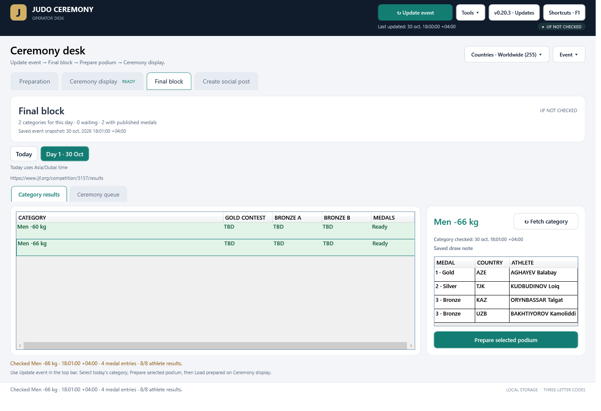

*Illustrative rehearsal data. Some detailed illustrations below show earlier versions; use the four tabs and Tools menu described here for current navigation.*

### Preparation

Category buttons stay visible beside the event details and medal countries. Search by three-letter code or country name. Preparing another category leaves the loaded audience ceremony intact until you explicitly load a replacement.

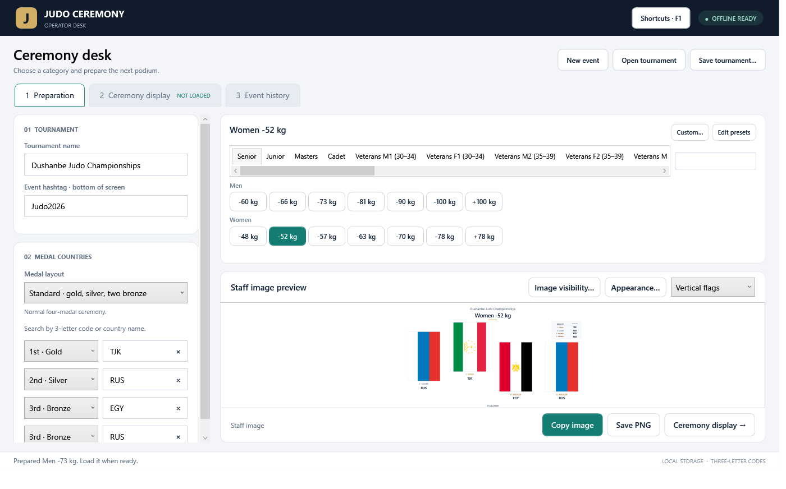

### Ceremony display

This workspace contains monitor selection, loading, playback, elapsed time, raising duration, audience visibility and a preview. The audience runs in its own window, on the HDMI screen or in a windowed rehearsal on the same PC.

### Final block

**Today** shows the categories scheduled for the current event-local date. Other days have separate dated buttons. The app uses the published schedule and event timezone; categories without a reliable schedule appear separately.

Known gold and bronze matchups remain unranked until medals are published. Undecided contestants show **TBD**. Select a published category, review any unusual layout and click **Prepare selected podium**. This fills Preparation; it never starts the audience ceremony.

**Category results** and **Ceremony queue** are view tabs. Green means four usable medal entries, including a valid no-gold/two-silver case. Partial and empty categories are grey. Fifth and seventh places are optional for podium readiness; shorter approved podiums remain available.

### Create social post

This tab follows Final block. Choose a day and category, then **Create / edit social post…**. The editor remembers each category's design and receives updated published athlete rows from the event snapshot.

### Tools

| Tool | Use |
| --- | --- |
| Event history | Reopen previous events and their saved category countries. |
| Anthem testing | Browse, load and test recordings without changing the loaded ceremony. |
| Event readiness | Check participant flag references, recordings, preparation, branding and the selected display. |

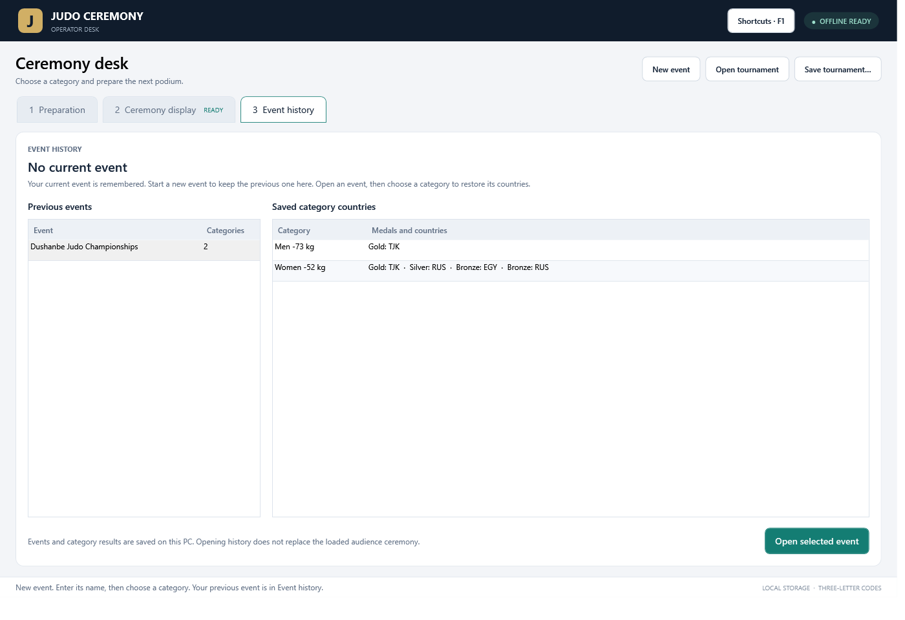

Opening an event leaves Preparation empty until you select a category. The audience continues using its existing loaded snapshot.

## Event updates and quick category fetch

**Update event** in the top bar is the shared full-event action. Connect an IJF competition link once, then use it to refresh event details, participation, daily categories, final-block matchups, medals and top-eight athlete results.

**Last updated** shows the last successful shared update and survives restart. Failed requests retain the saved data and previous timestamp. **Partial update** indicates unavailable pages; hover over the timestamp for details. Connectivity is shown beside the update status.

For a faster check, select a category in Final block and click **Fetch category** beside its heading. This reads the results page once and updates only that category and its remembered/open social posts. It skips event information, participant, schedule and draw downloads.

| Action | Scope | Time shown |
| --- | --- | --- |
| Update event | The whole event and its social-post results | Last updated in the top bar |
| Fetch category | The selected category's medals and social-post athletes | Category checked beside that category |

A category fetch does not advance the full-event timestamp. Both actions retain manual preparation and the loaded audience ceremony. Pending pages do not erase already published medals. Missing countries, medals and athlete places are never invented.

Use **Event → New event** before connecting another competition. Saved snapshots work offline; fetching new information requires internet access.

## Automatic refresh and change reports

The timer is directly in the top bar on every workspace. Connect an IJF competition with **Update event**, then check **Auto-refresh** and choose an interval beside it. Wide or maximized windows place the timer and update/connection status in the top row. Smaller windows keep two rows so the controls fit.


*Illustrative rehearsal. The timer starts off each session.*

| Interval | Selection |
| --- | --- |
| Short checks | 2, 5, 10 or 30 seconds |
| Longer checks | 1, 2 or 5 minutes |
| Custom | Any whole number from 2 to 3600 seconds |

The same timer controls are also at the top of **Changes**: its checkbox, interval, custom seconds and countdown stay synchronized with the header. You can use either location.

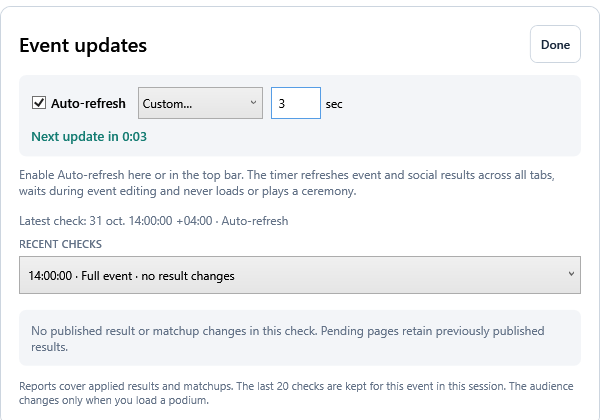

The default is one minute. **Next update in…** shows the countdown. The interval starts after each request finishes; a slow request never overlaps another check. Failed requests retain saved results and retry after the chosen interval. Invalid custom values pause requests until corrected.

The timer refreshes the full event and shared social-post results across tabs. It waits while event inputs are being edited, and defers an automatic response that arrives during editing. Focus in the timer's own controls does not block it. Switching events turns the timer off. Uncheck Auto-refresh to stop future checks.

Open **Changes** beside Update event to review category-by-category differences: new gold/silver/bronze results, fifth/seventh places, changed countries, added or corrected athlete names, removed results, updated final-block matchups and review notices. Corrections show previous and new values.

The last **20 successful checks** are available in the report selector, including checks with no changes. Before the first successful check, the panel shows instructions and hides the empty report selector. A successful unchanged check shows its own message and retains the selector. Browsing reports leaves the timer running. A failed check retains previous reports. History is kept for the current event in this session; saved results remain available after restart and form the baseline for the next comparison. The summary covers results and matchups, rather than event metadata or participation changes.

Pending pages do not falsely report deletions when existing medals are retained. Reordering two bronze, fifth or seventh results does not create a change. Duplicate-country athletes remain separate results.

Automatic updates keep entered preparation and the loaded audience intact. **Prepare**, **Load** and **Play** remain explicit operator actions. See the [timer and report guide](docs/RELEASE-0.21.md).

## Run today's ceremony queue

In **Final block**, choose **Today** or a dated day, then **Ceremony queue**. **Add this day** includes its scheduled categories; **Add preparation** adds a manually prepared podium. Use **Move up**, **Move down** and **Remove** to arrange the order. Adding a day twice does not duplicate it.

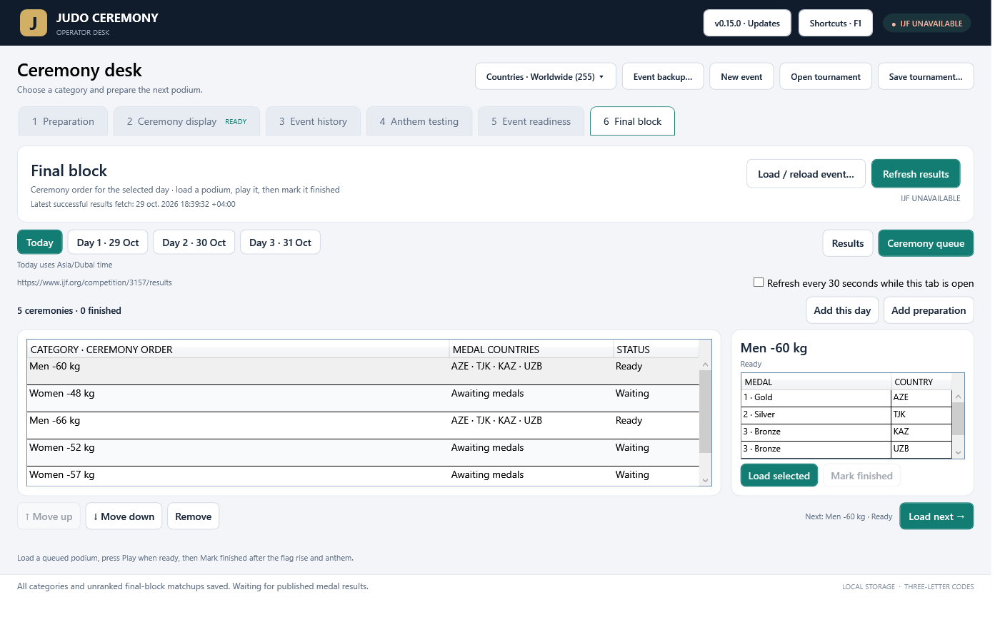

The medal table previews the selected podium. **Load selected** loads it without autoplay. **Load next →** loads the first unfinished entry in the selected day's order; it waits if that entry still needs results or review. Press **Play** on Ceremony display when ready. After flags have finished and the anthem is stopped, return to the queue and **Mark finished**.

Statuses include Waiting, Ready, Review layout, Loaded, Playing, Paused, Awaiting finish and Finished. Imported unusual layouts require review before loading; no-gold podiums select no winner anthem. Active flags or ceremony audio block loading another queued podium. Reordering does not alter the loaded countries. Finished entries retain the countries actually presented. Queue order and completion are saved with the event and portable backups.

## Social media exports

Open **Create social post**, immediately after Final block. Choose a day and category, then **Create / edit social post…**. You can also enter results manually before a podium is prepared.

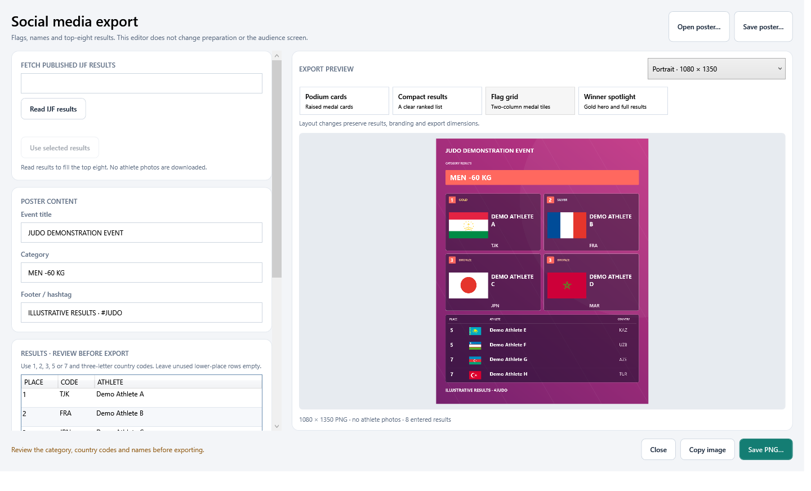

1. Use **Update event** to obtain the event's published results, or **Fetch category** in Final block for one category. Review the country codes and athlete names in the editor.
2. Choose **Podium cards**, **Compact results**, **Flag grid** or **Winner spotlight**. Switching layouts preserves results and branding. No-gold spotlight layouts show the medallists without inventing a winner.
3. Choose the dimensions, **Magenta**, **Navy** or **Teal** palette, footer/hashtag, background and logos. **Include 5th and 7th places** controls the lower placings.
4. Use **Copy image** or **Save PNG…** at the selected resolution.

| Format | PNG dimensions |
| --- | --- |
| Portrait post | 1080 × 1350 |
| Square post | 1080 × 1080 |
| Story | 1080 × 1920 |

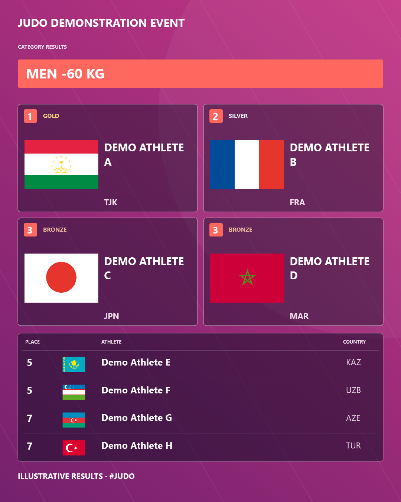

These illustrations use rehearsal data. There are **no athlete photos**. Posters use horizontal flags and support shorter or no-gold/two-silver podiums. Fifth and seventh places never become ceremony medals.

### Remembered designs and shared results

Valid edits save automatically on this PC for each event, division and category. Reopening the editor or restarting restores its design. Invalid edits retain the last valid saved poster.

**Update event automatically refreshes the athlete rows in remembered and open posts**, including all eight athletes when published: gold, silver, two bronze, two fifth and two seventh places. Fetch category does the same for its selected category. No second import/apply step is needed. Layout, dimensions, palette, branding, footer and custom heading are preserved.

**Save poster…** exports a `.judo-social.json` project containing the design, results, source information and embedded artwork, up to 25 MB. **Open poster…** replaces the selected category's draft. Format-2 projects need 0.18 or newer; format-1 projects still open.

The event's shared result snapshot is included in event files and backups. Remembered poster designs and separate poster projects are local and **not included in event backups**; use Save poster to transfer a design. Editing a poster leaves Preparation, the ceremony queue and the audience unchanged.

## Optional athlete names

Use **Update event** or **Fetch category** to obtain published athlete names. Review them before preparing a podium or exporting a social post.

On **Preparation**, expand **Athlete names · optional** below the medal countries to review, correct or enter the names. They follow the four medal entries. Changing a country clears its old name. Returning to an entered category restores its names; new categories start blank. Missing or ambiguous names stay blank rather than being guessed, and separate athletes from the same country remain separate entries.

Names are **off by default** in preparation images. Enable **Results table** and **Athlete names in table** in **Preparation → Image visibility…** for the staff preview, Copy image and Save PNG. The ceremony preview and HDMI output always omit athlete names, including enabled settings restored from 0.16 events. The audience athlete-name checkbox has been removed. Social posters have their own name fields. Names may use an ellipsis visually; the full name remains editable, up to 160 characters.

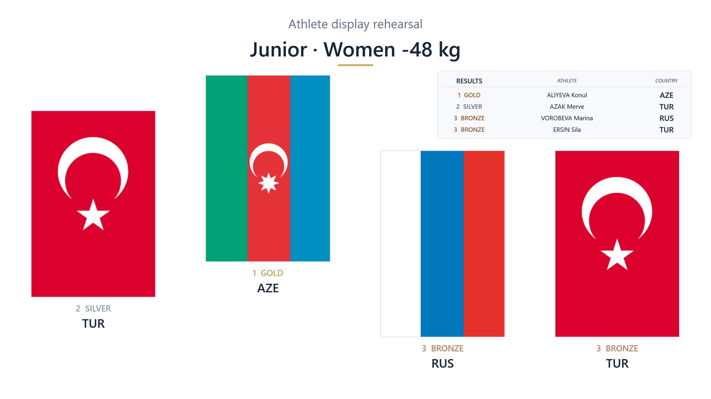

This is a rehearsal staff-image illustration with sample medal data. Names remain available in Preparation, category history and completed queue records. They can appear in staff images and the separate social poster editor; ceremony output always omits them.

## Separate visibility controls

Staff instructions and the audience screen can show different information. Event text and artwork are shared; visibility is selected separately for each output.

| Output | Where to change it | What updates |
| --- | --- | --- |
| Staff image | **Preparation → Image visibility...** | The staff preview, **Copy image** and **Save PNG**. |
| Audience screen | **Ceremony display → Audience screen visibility** | The audience preview and HDMI output. |

Both sets independently control:

| Element | Staff image | Audience screen |
| --- | :---: | :---: |
| Tournament title | ✓ | ✓ |
| Contest category | ✓ | ✓ |
| Flags and attached labels | ✓ | ✓ |
| Medal labels | ✓ | ✓ |
| Three-letter country codes | ✓ | ✓ |
| Full country names | ✓ | ✓ |
| Results table | ✓ | ✓ |
| Athlete names in the results table | ✓ | — |
| Event hashtag | ✓ | ✓ |
| Logos | ✓ | ✓ |

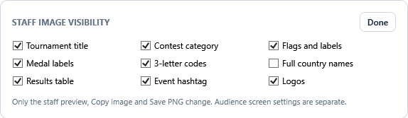

Changes apply immediately to the corresponding output and save with the event. Audience visibility edits preserve countries, elapsed time, pause and blackout. Image visibility edits leave the audience unchanged.

Hiding flags also hides their attached labels and disables those label controls for that output. The results table is a separate option and uses three-letter codes independently of the labels under flags.

<details>
<summary><strong>Example: detailed staff image and simpler audience screen</strong></summary>

The same illustrative podium can include medal labels, codes, full country names and a results recap for staff, while the audience sees the flags and event titles.

**Staff image**

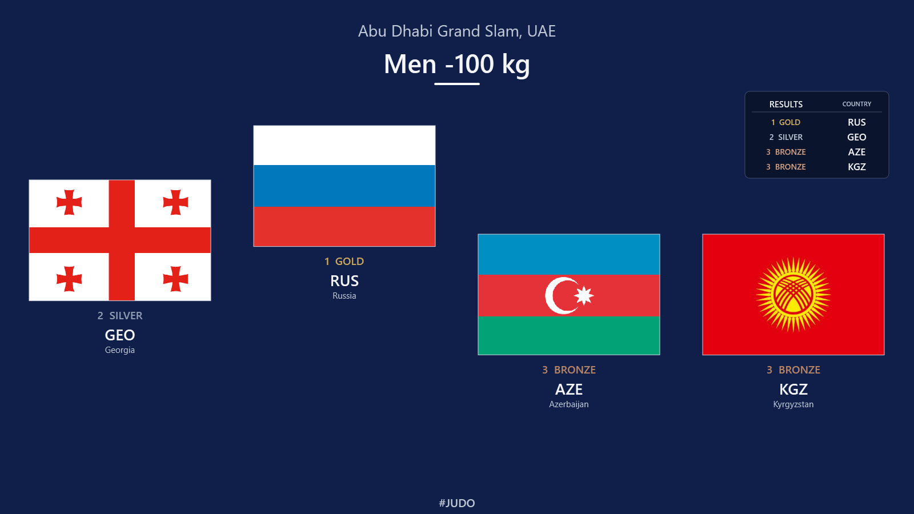

**Audience screen**

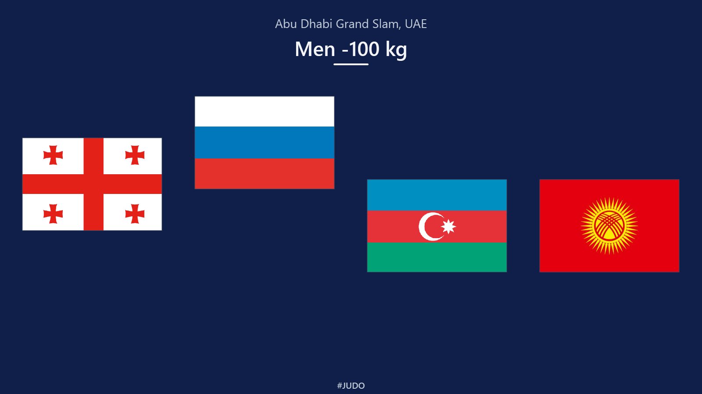

</details>

## Countries and categories

### Countries

Search by a three-letter code or country name. Examples include **TJK**, **RUS**, **FRA**, **GER**, **SUI** and **EGY**. The catalog uses sports codes where supplied, with ISO alpha-3 fallbacks for other entries.

Duplicate countries are supported: the same country can appear in more than one medal position. Published medal-athlete names can be fetched from IJF results, reviewed and optionally shown in the results table.

**Tab** moves to the next enabled country field and cycles back after the last field. **Shift+Tab** moves backwards. Medal selectors and country fields marked **Not awarded** are skipped.

### Categories

Choose a division, then click the visible men's or women's weight-category buttons. Presets include senior, junior, cadet and veterans divisions, plus editable open, team and other labels. **Custom...** and **Edit presets** support local event categories.

A new category starts with empty country fields and the standard medal layout. Returning to an entered category restores its own countries and medals. Different divisions and weights keep separate results, including partially entered or cleared countries.

Senior is available as a division filter but is omitted from the displayed contest title. Other division labels, such as Junior and Cadet, remain in their titles.

## Medal layouts

| Layout | Presentation |
| --- | --- |
| Standard | Gold, silver and two bronze medals. |
| No gold · two silver | Two silvers, an empty gold position and two bronzes. |
| One bronze | Gold, silver and one bronze medal. |
| Gold and silver only | Two awarded medals. |
| Gold only | One centered awarded medal. |
| Custom | Choose Gold, Silver, Bronze or Not awarded for each entry. |

The standard audience order is **silver · gold · bronze 1 · bronze 2**. Gold finishes highest; silver is lower; both bronzes finish at the same height.

For an approved two-silver, no-gold result, the display reserves an empty gold position between the silvers and bronzes. No flag or label is drawn in the missing position. Both silvers finish at the same height.

Use the result approved by event officials, including the applicable double hansoku-make outcome. The application presents the selected medals; it does not determine disqualification consequences or calculate competition results.

## HDMI display

1. Connect the audience display and press **Win+P → Extend** in Windows.
2. On Ceremony display, click the **refresh arrow** and select the intended monitor. Use **Windowed preview** for rehearsal without a second screen.
3. Set a raising duration between **3 and 300 seconds**. Type the value or use the up/down arrows. Load the preparation to use its new duration.
4. Click **Load prepared →** to open the audience window and capture the prepared podium.
5. Use the controls below during the ceremony.

| Control | Behavior |
| --- | --- |
| Play / Resume | Start or continue the loaded animation. |
| Pause | Freeze the flag movement. |
| Restart | Immediately replay the loaded ceremony from its beginning. |
| Reset | Return flags to the starting positions; confirms when active. |
| Black screen | Make the complete audience output black and pause movement. |
| Restore screen | Restore the picture while leaving movement paused. |
| Close display | Close the audience window; confirms when active. |

Reset an active or paused ceremony before loading a replacement. Restart uses the loaded podium and its duration; it does not load pending preparation edits.

If the audience monitor disconnects, the application pauses and closes that output window. Reconnect the monitor, refresh the list, select it and reopen the display before resuming.

## Anthem playback

**ANTHEM · BETA FEATURE. We accept no responsibility for anthem accuracy or playback. Verify the recording with event officials before use.**

This warning appears on the ceremony operator page and anthem testing panel. The audience screen and exported staff image do not include the warning.

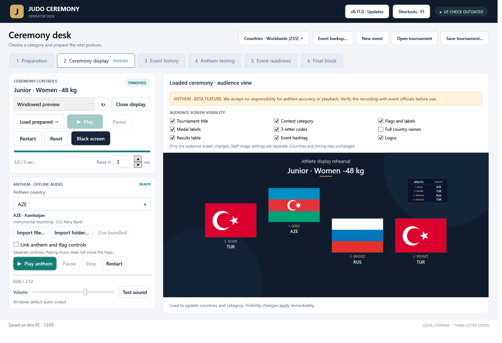

Rehearsal screenshot with sample preparation edits and athlete-table controls.

**146 instrumental recordings are included.** The remaining 109 catalog entries support local recording imports.

### Separate controls first

Loading a ceremony selects its gold winner's three-letter country code and opens the local recording without playing it. A ceremony with no gold selects no anthem. Choose a country manually when needed. Changing preparation, selecting another category, opening history or switching tabs does not replace the loaded anthem.

The anthem has its own **Play / Pause / Stop / Restart**, progress, duration and volume. **Play** resumes paused music; after it finishes, Play starts it again. **Stop** returns the music to its beginning. Music can run before the flags, after the flags, or with no audience window when controls are separate. Flags remain at their final height when music ends. Closing the application closes its audio decoder and stops music.

**Test sound** plays a two-second tone through the Windows default audio output. Choose the venue speakers in Windows sound settings and test the connection before playing a recording. The tone is separate from the selected anthem and never raises flags. Changing the recording is disabled while an anthem is playing or paused; Stop first.

### Optional linking

**Link anthem and flag controls** starts unchecked each time the app opens. Checking it never starts playback. Choose the link setting before starting; it is locked while either output is active.

When linked, the Play, Pause and Restart buttons in either panel operate both outputs. **Stop / Reset** stops the anthem and returns flags to their starting positions, with confirmation while a ceremony is active. Existing flag shortcuts also operate linked audio. Black screen pauses linked audio; restoring the picture does not resume it automatically. Closing or disconnecting the audience display pauses linked music. With separate controls, flag operations do not change the music.

Both the loaded ceremony and a ready recording are required before linked playback can start. Missing, loading or failed audio cannot silently start the flags. A decoder failure pauses a linked flag rise. If the flags finish first, the music continues and can still be paused and resumed with the linked controls. If music finishes first, the flags finish their configured rise. Restart begins both again.

### Recordings and imports

The bundled library contains selected instrumental U.S. Navy Band performances documented by their original Wikimedia Commons file pages. Recordings come from Commons originals/derivatives, source-matched public-domain mirrors and an archived original Navy source for USA. `Assets/Anthems/catalog.json` records each recording's country code, original page, performer, license metadata, acquisition source and SHA-256. The mapping is explicit; historical and questionable entries are not assigned merely by guessing a filename. These are reference recordings, not a claim of IJF approval or of the version required by a particular event. Rehearse the recording selected for each winning country.

**Import file…** copies a preferred recording for the selected country into `%LOCALAPPDATA%\JudoCeremony\anthems`, using a filename such as `TJK - Tajikistan.mp3`. Local imports override bundled recordings. **Use bundled** removes that country's imported override and returns to the supplied track, where available. Your source file is not changed.

**Import folder…** reads MP3/WAV files directly in a chosen folder whose names begin with a known three-letter code, such as `FRA.mp3`, `TJK - Tajikistan.wav` or `GER_Anthem.mp3`. It rejects duplicate recordings for one code before importing. Unrecognised filenames are skipped and counted. Imported files must have a matching audio header and be at most 100 MB; Windows checks decoding when opening a track. Files that cannot play are shown as failed, with replacement available.

Recordings are shared on this PC across events. The link checkbox, selected manual anthem and volume are session controls. Audio files are not embedded in tournament exports or event-history files. To move your overrides to another PC, copy the `anthems` folder into that PC's Judo Ceremony data directory. A `--data-dir` rehearsal has its own imported library.

The application makes no network requests for playback. A country outside the included library shows **No recording available** and supports importing a preferred version. Coverage and source review are documented in `docs/ANTHEM-LIBRARY.md`.


### Anthem testing panel

Open **Tools → Anthem testing** to browse all 255 country/delegation entries independently of the loaded ceremony. Search by three-letter code or country name, then filter **All countries**, **Available**, **Missing** or **Needs attention**. The table distinguishes bundled recordings from local imports. Failed recordings are marked Needs attention when tested; Refresh reloads current file availability.

Select a row to see its flag and load the recording without autoplay. Use the panel's own **Play / Resume, Pause, Stop and Restart**, seek slider, elapsed time and volume to listen to any part of the track. **Refresh** discovers newly imported or replaced files. Missing recordings can be imported on Ceremony display and then refreshed here.

The test player does not change medal countries, flag positions, the selected ceremony anthem, link preferences or the ceremony volume. Test audio stops when leaving this tab or starting ceremony playback. Listening is blocked while ceremony audio is playing or paused, or while a flag rise is running or paused. Browsing remains available. Space operates the focused preview control; the function keys remain ceremony shortcuts.

## Shortcuts

| Key | Action |
| --- | --- |
| Space | Play, pause or resume. |
| F5 | Play / resume. |
| F6 | Pause. |
| F7 or Ctrl+R | Restart the loaded ceremony. |
| F8 | Reset to starting positions. |
| F9 or Ctrl+B | Black screen / restore. |
| Ctrl+Enter | Load the preparation. |
| F1 | Show shortcut help. |
| Esc in the audience window | Close the display; confirms when active. |
| Tab / Shift+Tab in country fields | Move forward / backwards between enabled country fields. |

Ceremony shortcuts work with the operator or audience window in focus. They are not system-wide hotkeys. Held keys do not repeat ceremony actions. Space retains its normal behavior in text fields, checkboxes, lists and history selection.

## Branding

Open **Appearance...** beside the staff preview to configure the event artwork.

- Choose **Guide blue**, **Blue gradient**, **Dark blue** or **White & blue**.
- Set a custom background color, or import a PNG, JPEG or BMP background.
- Adjust background darkening for readable titles.
- Add logos at the top-left, top-right and bottom-center. Logos keep their proportions and PNG transparency.
- Enter an optional event hashtag below the tournament name. A leading `#` is added when needed; multiple space-separated hashtags are supported.

Background presets are based on an IJF-published event-guide palette. They are display presets rather than event-approved artwork.

**Include appearance in staff images** selects whether staff exports use the same artwork or the white staff layout. The independent visibility checkboxes determine which elements are shown on each output. Background and logo artwork are configured through Appearance; their visibility can differ between outputs.

Imported images are embedded in the event file, so moving the original picture files does not break a saved setup. Tournament files, including embedded artwork and category results, are limited to **25 MB**.

## Country filters and participation

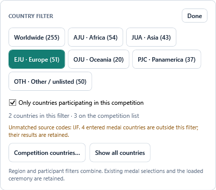

### Worldwide and continental unions

Choose **Worldwide**, **AJU · Africa**, **JUA · Asia**, **EJU · Europe**, **OJU · Oceania**, **PJC · Panamerica**, or **OTH · Other / unlisted**. Worldwide includes all 255 catalog entries. Union membership comes from an offline snapshot of the official IJF federation pages checked on 28 October 2026. Other / unlisted contains catalog entries not assigned by those five member lists; it is not a claim that they are IJF members.

| Scope | Catalog entries |
| --- | ---: |
| Worldwide | 255 |
| AJU | 54 |
| JUA | 43 |
| EJU | 51 |
| OJU | 20 |
| PJC | 37 |
| Other / unlisted | 50 |

This uses judo membership rather than geographic guesses. France and Türkiye are included in EJU; Kazakhstan is included in JUA. IJF aliases SGP, NFI and MNP map to the app's existing SIN, NFK and NMI catalog identities. The app continues to display its existing three-letter codes and flag artwork. Membership does not establish eligibility for a particular event.

### Competition country list

Select **Competition countries…** to edit a draft list. Search countries, filter the editor by region, check individual countries, or use **Add shown / Remove shown**. Changes reach the current event only with **Save changes**; Cancel keeps the existing list.

You can also paste three-letter codes separated by spaces, commas, semicolons or line breaks, for example `TJK FRA GER JPN`, and choose **Replace list with codes**. **Load code list (.txt / .csv)…** accepts a plain code list; CSV files should contain country codes only, with an optional Code/NOC header. Names and other text are rejected rather than guessed. Duplicate codes are combined and supported ISO/IJF aliases are resolved.

Enable **Only countries participating in this competition** in the Countries menu to restrict suggestions to that list. Region and participation filters combine: EJU plus a participant list shows the European-union members on that list. An empty enabled list shows zero choices instead of reverting to Worldwide. **Show all countries** removes both restrictions while preserving the saved participant list.

Changing filters never clears entered medal countries, replaces the loaded podium, changes flag positions or switches the loaded anthem. The menu identifies existing prepared medal countries outside the new scope. Selecting a new category still restores that category's own results as before.

### IJF participation

Use **Update event** in the top bar to fetch the official competition's event information and participating countries together. Review the saved participation list in **Countries → Competition countries…**. Imported countries and regional filters remain available offline.

Each event keeps its own scope, participation list and imported information. Start a separate event with **Event → New event**; editing the current name simply renames it.

## Event history and files

### Remember the current event

The app remembers the event name, appearance, hashtag, category presets and visibility preferences. On launch, category and country fields start empty. Select a saved category to restore its countries.

### Start another event

Choose **Event → New event** to save the current event to history and begin an empty event. Editing the current event name renames it; New event creates a separate event identity, even when the names match.

Entered countries in an unnamed event are retained in history under **Untitled event**.

### Export and reopen

**Event → Save tournament…** creates a `.judo.json` file containing that event's settings, category results and embedded artwork. **Event → Open tournament** saves the current event first, then opens the selected event. Select a category to restore its results.

Event history stays on this computer. Export a tournament file to move one event to another computer or keep a backup.

| Local data | Location |
| --- | --- |
| Current event | `%LOCALAPPDATA%\JudoCeremony\last-tournament.json` |
| Event history | `%LOCALAPPDATA%\JudoCeremony\events\` |
| Remembered social posts | `%LOCALAPPDATA%\JudoCeremony\social-posts\` |

If the current autosave cannot be read, the original is preserved in an `.invalid-...` recovery copy and the app reports the problem. Close older versions before starting another build; the session lock prevents simultaneous copies from writing to the same saved session.

### File compatibility

Version 0.21.4 saves **event schema 9**, including the shared top-eight result snapshot and Last updated. Newly saved events need **0.20 or newer**. Schema 1–8 events still open with their existing migration defaults.

Saved category countries, athlete names, output preferences, final-block plans, ceremony queue and completed podiums stay with the event. Athlete names remain available for preparation images and social posts; ceremony output always omits them.

Social poster format 2 is separate from the event file and requires 0.18 or newer. Close older app versions before launching another build; the session lock prevents simultaneous copies from writing the same saved session.

## Portable event backup

Use **Event → Event backup… → Create backup ZIP…** to move an event to another PC. The `.judo-backup.zip` contains event settings, category countries and layouts, the shared results, queue, embedded branding and relevant imported recordings. Bundled artwork and recordings come with the app and are not duplicated.

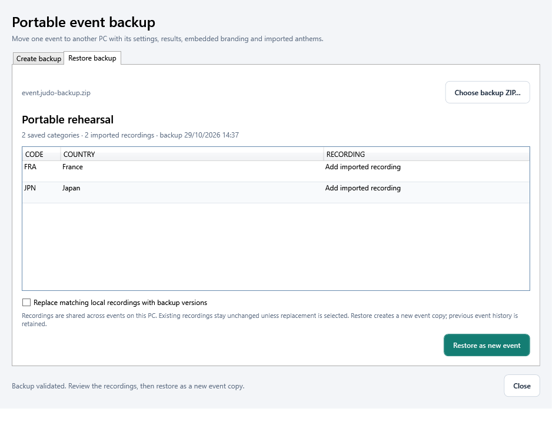

On the other PC, extract Judo Ceremony Desk **0.20 or newer**, open **Event → Event backup… → Restore backup**, then choose the ZIP. Review its event and recordings before **Restore as new event**. Existing history is retained. Select a saved category to restore its podium.

Leave **Replace matching local recordings with backup versions** unchecked to keep local overrides. Replacing a recording changes that country's shared recording across events on that PC. The preview checks sizes, hashes, event structure, branding and audio headers before restoring. Imported recordings still need a playback test.

Backups use format 1 with a schema-9 event. Expanded content is limited to 2 GB, event JSON to 25 MB and each recording to 100 MB. Poster designs are separate: use **Save poster…** for those. Ordinary tournament files contain the shared event data and artwork, but do not embed imported recordings.

## Event readiness

Open **Tools → Event readiness** before the ceremony. Check participant flag references, anthem availability, preparation, branding and the selected audience display. Use **Refresh checks** after making changes; the report is a snapshot.

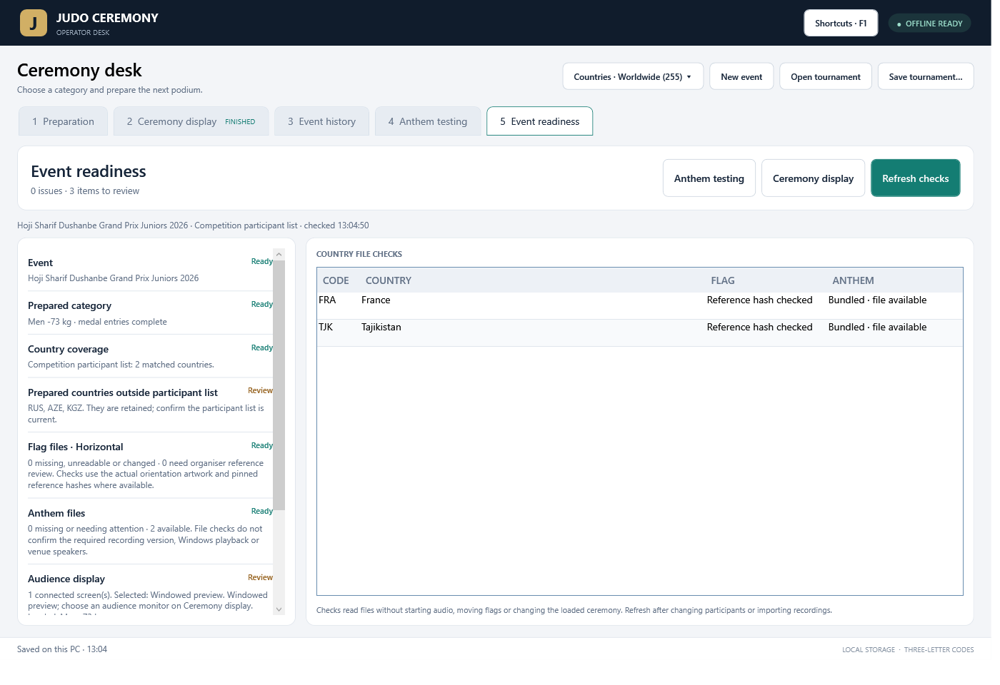

Readiness does not start playback or change medal countries. Confirm event-approved medals, recordings and display choices with the event team.

## Installed version and updates

The title bar and **v0.21.4 · Updates** button identify the running build. Open the version window and choose **Check for updates**. It reads published Windows releases, including previews, and shows a newer version when available. Drafts and unrelated downloads are ignored.

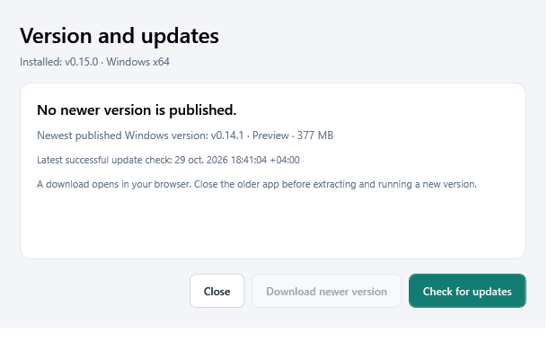

**Download newer version** opens the official release page in your browser. Close the older app, extract the new Windows ZIP and open its EXE. The check is manual, requires internet and does not install software. A failed check reports unavailable and retains its last successful check time. The window can remain open while you use the operator desk.

See [complete operation, limits and compatibility](docs/RELEASE-0.21.4.md).

## Flag audit

The artwork was checked against **FlagChecking v1.5e** and the **IJF Flag Manual dated 1 April 2026**. The newer IJF manual takes priority when the sources disagree.

| Coverage | Count |
| --- | ---: |
| Catalog entries | 255 |
| Horizontal and vertical views reviewed | 510 |
| Countries covered by the newer IJF manual | 205 |
| Additional countries covered by the workbook supplement | 16 |
| Countries with reference-backed artwork | 221 |
| Entries outside both references, requiring organizer review | 34 |

The interface identifies selections outside the references for organizer review. The catalog is not an event-eligibility list. Special delegation gaps, source defects and remaining differences are documented in the audit.

The **16-page searchable PDF** includes a differences table with separate flag images, selectable text and the complete comparison sheets. Use **Ctrl+F** to find country names, codes or comparison results.

The PDF describes the **0.7 flag audit**; its artwork is unchanged in 0.21.4. Its software-test count belongs to that earlier release. Current software and package checks are listed below.

Individual flag filenames use a three-letter code and full name, for example `TJK - Tajikistan.png`. The standalone archive contains **255 horizontal PNGs** and **221 vertical reference designs**. Source artwork resolution limits sharpness when enlarged; check the actual audience screen at event distance.

## Release validation

The final v0.21.4 build passed **68 report/timer/layout checks**, **31 event-workflow checks**, **17 category-fetch/header checks** and **270 queue/update checks**. These suites overlap; the counts are not a unique total. The earlier 0.20 base passed 692 regression checks.

The Windows package passed native launch, fresh start, event reopening, embedded icon, **442 reference-image hashes** and **146 anthem hashes**. The unchanged recordings match the existing successful Windows decoder audit. Physical HDMI and venue-speaker rehearsal remain manual.

See the [current release notes](docs/RELEASE-0.21.4.md) and [short demonstration guide](docs/BOSS-DEMO.md).

## Troubleshooting

| Problem | Check |
| --- | --- |
| The application does not start | Extract the entire Windows x64 ZIP, keep the package files together and close any older running copy. |
| Country fields are empty after opening | Select a category. Empty startup is intentional; saved category results are restored when selected. |
| A new category shows no countries | Enter that category's results. Countries are not carried over from another category. |
| The audience is showing the previous podium | Load the prepared category when ready. Preparation and loaded ceremony are separate. |
| A staff-image change is missing on the HDMI screen | Set the audience's own visibility options on Ceremony display. |
| An audience change is missing from Copy image | Use Image visibility on Preparation for staff-image contents. |
| The second monitor is missing | Check Windows Extend mode, the HDMI connection and the monitor's power; then refresh the display list. |
| The restored screen is not moving | Blackout pauses playback. Press Play / Resume after restoring the picture. |
| An older app rejects the event file | Schema 9 needs 0.20 or newer. Format-2 social projects require 0.18 or newer. |
| Finals are known but no medals appear | Use Update event. Final block shows matchups unranked until medals are published; Fetch category checks one category again. |
| A social post is missing athlete rows | Use Update event or Fetch category. All eight appear when published; saved design settings are retained. |
| I cannot see the timer | Open v0.21.4 and choose Changes: the timer is its first section. It is also in the header. Maximize for the single-row header. |
| The timer says Off | Connect an IJF event, then check Auto-refresh. It starts off each session. |
| The timer is waiting for editing | Finish editing an event field and move focus out of it. Timer settings themselves do not block updates. |
| Results looks unchanged | Category results is a view tab. Use Fetch category or Update event to request new information. |
| There is no anthem sound | Check the selected recording, volume and Windows default audio output; use Test sound. A missing track needs an imported MP3/WAV. |

Before live use, rehearse the approved podium, both flag orientations, the visibility choices, HDMI resolution/scaling and reconnection, and pasting the staff image into the chosen Windows application.

## Support and notices

For a problem report, [open an issue](https://github.com/YOUNESMAAFI/judo-ceremony-releases/issues). Include the app version, Windows version, steps to reproduce the problem, expected result and what happened. For display issues, include the monitor resolution and scaling.

Artwork and data sources are listed in [THIRD-PARTY-NOTICES.md](THIRD-PARTY-NOTICES.md). Microsoft .NET license and third-party notices are included in the application package. No IJF endorsement is implied.

---

<p align="center"><strong>Judo Ceremony Desk</strong><br>Offline preparation and ceremony display for judo event teams.</p>
