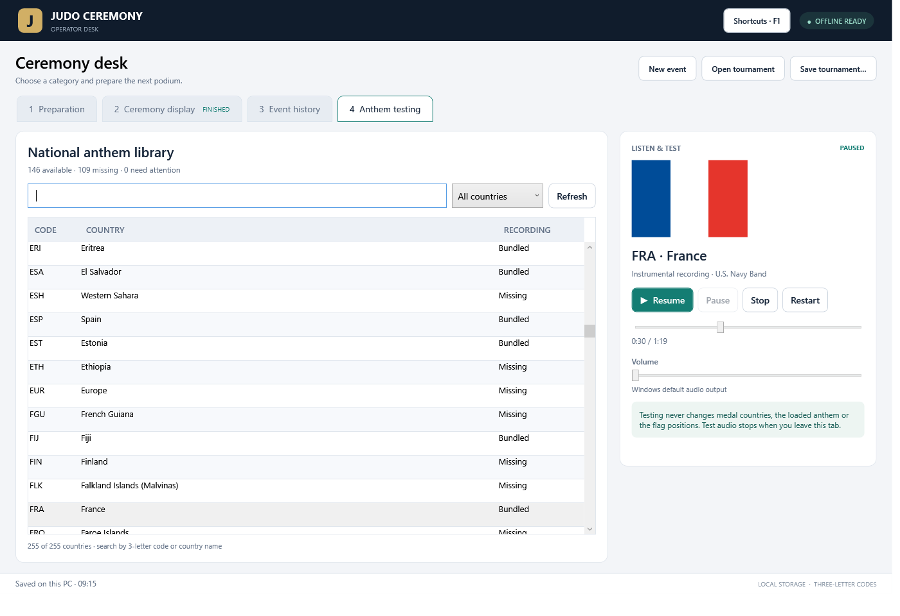
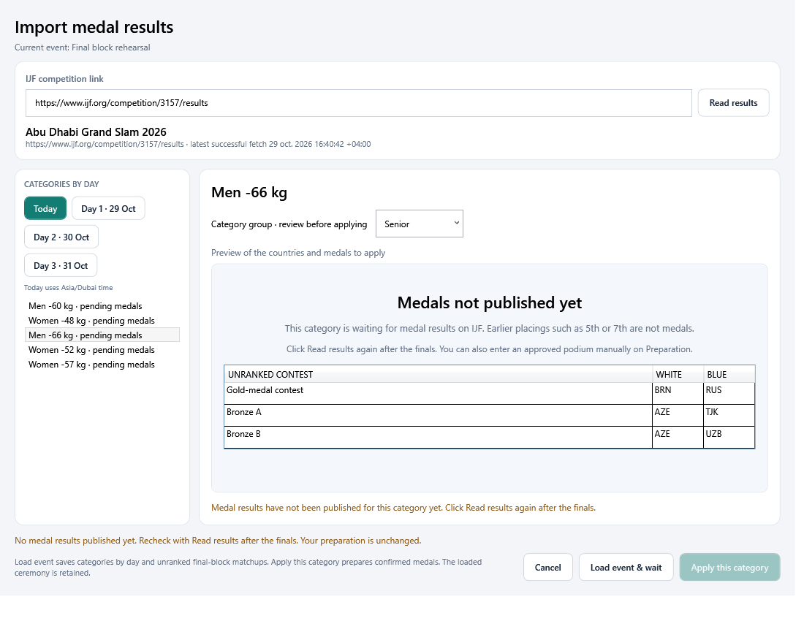
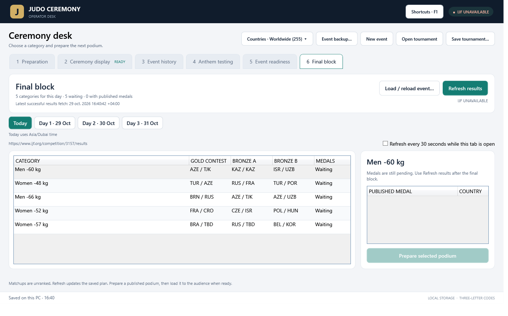
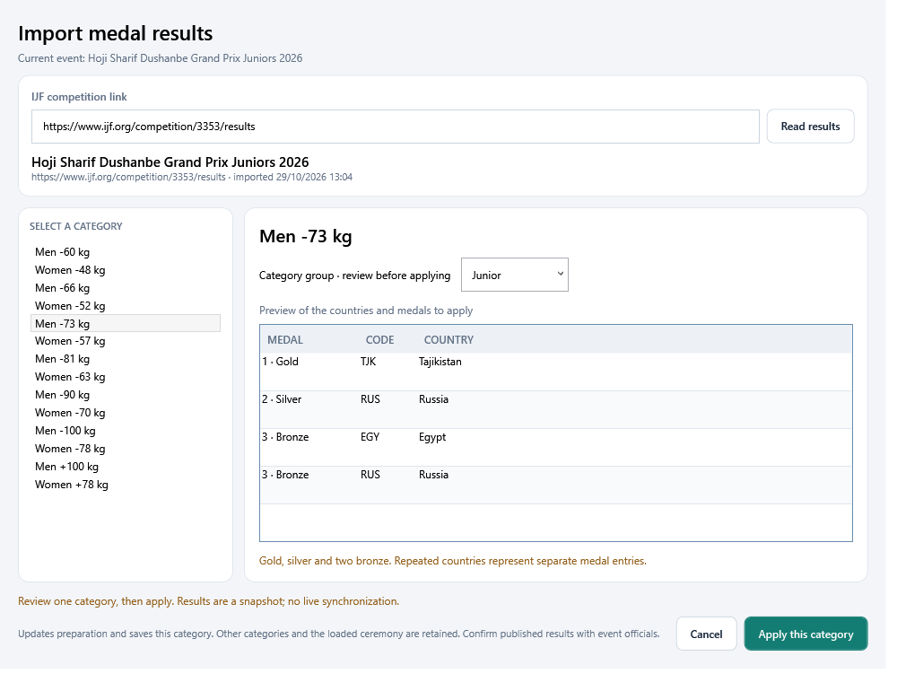
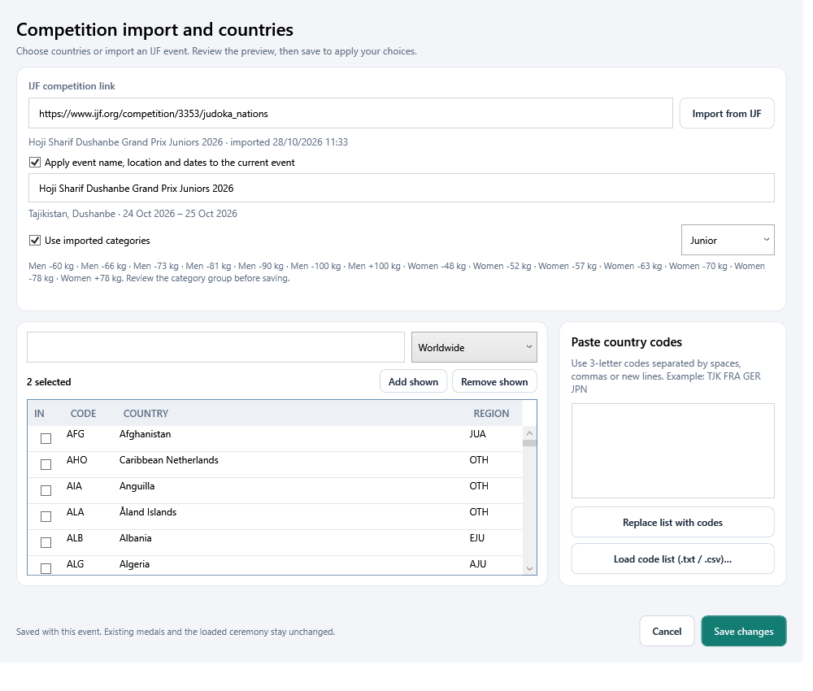
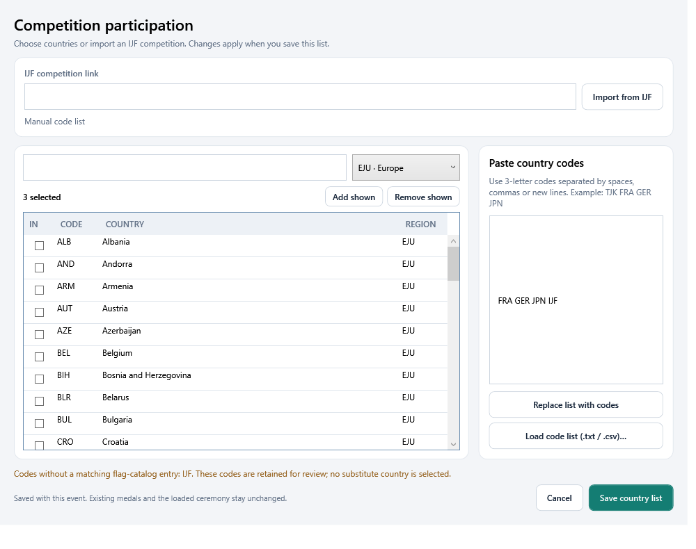
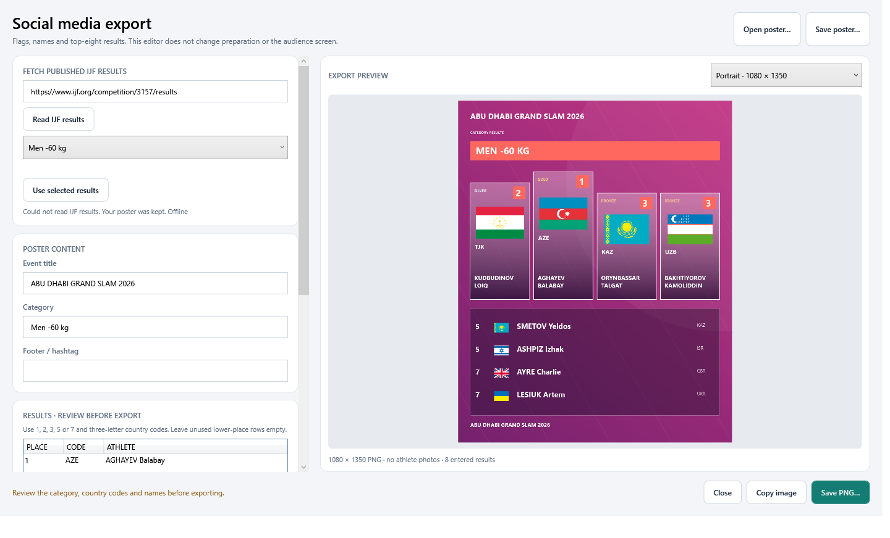
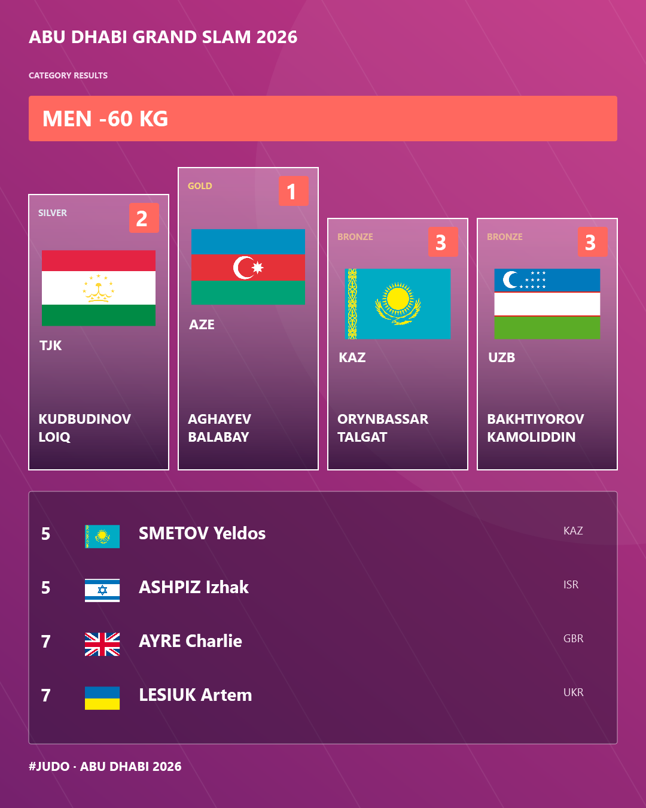

<p align="center">
  
</p>

<h1 align="center">Judo Ceremony Desk</h1>

<p align="center">
  <strong>Prepare the podium. Share the flag positions. Run the ceremony.</strong><br>
  An offline Windows application for judo award ceremonies and HDMI audience screens.
</p>

<p align="center">
  
  
  
  
</p>

<p align="center">
  <a href="https://github.com/YOUNESMAAFI/judo-ceremony-releases/releases/download/v0.17.0/JudoCeremony-0.17-win-x64.zip"><strong>Download for Windows</strong></a>
  &nbsp; | &nbsp;
  <a href="https://github.com/YOUNESMAAFI/judo-ceremony-releases/releases/tag/v0.17.0">Release notes &amp; downloads</a>
  &nbsp; | &nbsp;
  <a href="https://github.com/YOUNESMAAFI/judo-ceremony-releases/releases/download/v0.17.0/Judo-Ceremony-0.7-Audit-Searchable.pdf">Searchable flag audit</a>
</p>

---

## At a glance

Judo Ceremony Desk gives the operator a preparation workspace and a separate ceremony workspace. Prepare a category, copy a clear flag-position image for staff, then raise the flags on the audience screen when the ceremony begins.

| Capability | What you can do |
| --- | --- |
| Social media exports | Create portrait, square and story PNGs with flags, athlete names and top-eight results; no athlete photos. |
| Athlete names | Fetch IJF medal athletes, review names and optionally include them in preparation images and social posters. Ceremony output always omits athlete names. |
| Ceremony queue | Set the order for each day, load the next podium and mark ceremonies finished. |
| Version checks | See the installed version and check for a newer published Windows build. |
| Final block | Save known gold and bronze matchups before medals exist, then refresh published results. |
| Portable backup | Move an event, embedded branding and imported recordings to another PC in one ZIP. |
| Event readiness | Check participant flag references, anthem files, preparation and audience display status. |
| IJF medal results | Review a published category, then apply its medal countries to preparation. |
| Staff images | Copy a complete image or save a **2400 × 1350 PNG**. |
| Audience display | Run the flag animation in a separate window on an HDMI screen. |
| Independent controls | Choose which titles, labels, country names and tables appear in each output. |
| Country selection | Search **255 catalog entries** using three-letter codes or country names. |
| Category memory | Enter each category separately and restore its countries when you return. |
| Event history | Save previous events locally and reopen their categories. |
| Exceptional medals | Present two silvers with no gold, missing medals and other approved layouts. |
| Event branding | Add backgrounds, three logos and a hashtag footer. |
| Anthem playback | Play local instrumental recordings independently or link them to flag controls. |
| Offline use | Use bundled flag artwork and the included Windows runtime without an internet connection. |

**Version 0.17.0 is a preview for review and rehearsal.** Software checks and package checks pass; rehearse the actual event computer, HDMI screen and staff-image workflow before live use. Offline anthem playback is included, with separate controls and optional linking to flags.

## Contents

[Download](#download) · [Quick start](#quick-start) · [Workspaces](#workspaces) · [Social exports](#social-media-exports) · [Athlete names](#optional-athlete-names) · [Separate visibility controls](#separate-visibility-controls) · [Portable backup](#portable-event-backup) · [Readiness & results](#event-readiness-and-medal-result-import) · [Country filters](#country-filters-and-participation) · [Countries and categories](#countries-and-categories) · [Medal layouts](#medal-layouts) · [HDMI display](#hdmi-display) · [Anthem playback](#anthem-playback) · [Shortcuts](#shortcuts) · [Branding](#branding) · [Event history and files](#event-history-and-files) · [Flag audit](#flag-audit) · [Troubleshooting](#troubleshooting) · [Support and notices](#support-and-notices)

## Download

Download the Windows ZIP below, extract the entire folder and open `JudoCeremony.exe`. The runtime, flag assets, bundled recordings and illustrated guide are included.

| File | Use |
| --- | --- |
| [JudoCeremony-0.17-win-x64.zip](https://github.com/YOUNESMAAFI/judo-ceremony-releases/releases/download/v0.17.0/JudoCeremony-0.17-win-x64.zip) | Complete portable Windows application, runtime, assets, examples and documentation. |
| [Flags-PNG.zip](https://github.com/YOUNESMAAFI/judo-ceremony-releases/releases/download/v0.17.0/Flags-PNG.zip) | Individual horizontal and reference-backed vertical flag PNGs. |
| [Searchable audit PDF](https://github.com/YOUNESMAAFI/judo-ceremony-releases/releases/download/v0.17.0/Judo-Ceremony-0.7-Audit-Searchable.pdf) | The flag reference review, differences table and full visual comparisons. |
| [Release notes](https://github.com/YOUNESMAAFI/judo-ceremony-releases/releases/download/v0.17.0/RELEASE-NOTES.md) | Changes, compatibility and validation for this release. |
| [README.md](https://github.com/YOUNESMAAFI/judo-ceremony-releases/releases/download/v0.17.0/README.md) | A downloadable copy of this guide. |
| [Software check result](https://github.com/YOUNESMAAFI/judo-ceremony-releases/releases/download/v0.17.0/RELEASE-0.17-checks.txt) | Confirmation of the 582 passing software checks. |
| [SHA256SUMS.txt](https://github.com/YOUNESMAAFI/judo-ceremony-releases/releases/download/v0.17.0/SHA256SUMS.txt) | SHA-256 hashes for the release downloads. |

**Platform:** Windows x64. Windows 11 x64 is the development and test platform. The application ZIP includes the .NET runtime; a separate .NET installation is not required for normal use.

To check a downloaded file in PowerShell, run the command below and compare its hash with the matching entry in `SHA256SUMS.txt`:

```powershell
Get-FileHash -Algorithm SHA256 .\JudoCeremony-0.17-win-x64.zip
```

## Quick start

1. **Extract the complete application ZIP** to a local folder. Keep `Assets`, `Notices`, `examples`, `docs` and the other package files together.
2. Close an older running copy, then open **JudoCeremony.exe** in the extracted folder.
3. On **1 Preparation**, enter the event name once and select a category, such as **Men -73 kg**.
4. Choose the medal layout and select a country for each awarded medal. Search by a three-letter code, then select a result or press Enter.
5. Choose horizontal or vertical flags. Use **Image visibility...** to select the contents of the staff image, then **Copy image** or **Save PNG**.
6. For the audience, connect the second screen in Windows **Extend** mode. Open **2 Ceremony display**, choose the monitor and click **Load prepared →**.
7. Check the **Audience screen visibility** options and raising duration, then press **Play** when ready.

Sample tournament files are included in `examples`, including standard medals, a two-silver ceremony and a blue background with a hashtag. After opening a sample, choose its saved category to restore its countries.

## Workspaces

The desk has six workspaces. Version 0.14 adds **6 Final block** for loading the known matchups and waiting for published medals.

### 1 · Preparation

The first page keeps category buttons beside event details, medal countries, appearance settings and the staff-image preview.


The application starts with **no selected category or medal countries**. It remembers the current event settings. Select a category to begin or to restore that category's saved results.

Prepare the next podium while the current ceremony is loaded. Country, category, title and appearance edits reach the audience when you explicitly load the preparation.

### 2 · Ceremony display

This page contains monitor selection, loading, playback, elapsed time, raising duration, audience visibility options and a preview of the loaded ceremony.

The audience window is separate from the operator desk. It can run on the HDMI screen or as a windowed rehearsal on the same computer.

### 3 · Event history

Previous events and their saved category countries appear here. Select an event to inspect its categories, then choose **Open selected event**.


Opening an event leaves the preparation empty until you select a category. The loaded audience ceremony continues to use its existing snapshot.

### 4 · Anthem testing

Browse countries, search by three-letter code or country name, and filter available, missing or failed recordings. Select a country to see its flag and load a track without autoplay. The test player has its own playback, seek and volume controls.



Testing leaves the loaded ceremony unchanged. Test audio stops when leaving this tab or starting ceremony playback, and cannot overlap an active or paused ceremony. Use Refresh after importing or replacing a recording.

### 5 · Event readiness

Check participant flags, anthem availability, preparation, branding and the selected display without starting a ceremony. Refresh after making changes.

### 6 · Final block

**Today** shows only the categories competing on the event’s current local date. Other competition days have separate dated buttons. The app uses the official IJF schedule and event timezone; missing schedules appear separately under **Schedule unavailable**.

The header shows IJF connectivity, and the panel displays the **latest successful results fetch** with date, time, seconds and UTC offset. Failed refreshes keep that timestamp and the saved plan. [Day filtering and connection details](docs/RELEASE-0.14.1.md).

Open **Import IJF medal results…**, paste an official competition link and choose **Read results**. Review the source event and category group, then **Load event & wait**. The app saves all imported result categories, known gold-medal and bronze-medal matchups, event details and participants when available. An empty event name is filled; an existing name is retained. Category presets are merged. Previously entered medal countries stay intact.



Known contestants use three-letter codes in white/blue order; undecided slots say **TBD**. Finalists are unranked until IJF publishes the medals. Semifinal winner styling is never treated as a gold result.



Use **Refresh results**, or check **Refresh every 30 seconds while this tab is open**. Automatic refresh starts off and stops when you leave this workspace. It updates the saved plan without replacing manually entered medals, loaded flags or the anthem. Use **Load / reload event…** to update the matchups themselves. A pending source page cannot erase medals already published for that source/category.

Select a readable published category, review any unusual layout, and click **Prepare selected podium**. This fills Preparation. Load the prepared ceremony to the audience when ready. Unsupported draw formats or missing country codes require review; countries and medals are never guessed. Saved plans work offline; importing and refreshing require internet. See [full operation, limits and compatibility](docs/RELEASE-0.14.md).

## Run today's ceremony queue

In **6 Final block**, choose **Today** or a dated day, then **Ceremony queue**. **Add this day** includes its scheduled categories; **Add preparation** adds a manually prepared podium. Use **Move up**, **Move down** and **Remove** to arrange the order. Adding a day twice does not duplicate it.


The medal table previews the selected podium. **Load selected** loads it without autoplay. **Load next →** loads the first unfinished entry in the selected day's order; it waits if that entry still needs results or review. Press **Play** on Ceremony display when ready. After flags have finished and the anthem is stopped, return to the queue and **Mark finished**.

Statuses include Waiting, Ready, Review layout, Loaded, Playing, Paused, Awaiting finish and Finished. Imported unusual layouts require review before loading; no-gold podiums select no winner anthem. Active flags or ceremony audio block loading another queued podium. Reordering does not alter the loaded countries. Finished entries retain the countries actually presented. Queue order and completion are saved with the event and portable backups.

## Installed version and updates

The title bar and **v0.17.0 · Updates** button identify the running build. Open the version window and choose **Check for updates**. It reads published Windows releases, including previews, and shows a newer version when available. Drafts and unrelated downloads are ignored.


**Download newer version** opens the official release page in your browser. Close the older app, extract the new Windows ZIP and open its EXE. The check is manual, requires internet and does not install software. A failed check reports unavailable and retains its last successful check time. The window can remain open while you use the operator desk.

See [complete operation, limits and compatibility](docs/RELEASE-0.17.md).

## Portable event backup


Version 0.13 includes the event readiness panel and reviewed IJF medal-result import from 0.12, plus a portable backup for moving an event to another PC.

## Create a backup

Select **Event backup…** at the top of the desk, then **Create backup ZIP…**. Choose a destination such as a local folder or USB drive. The app creates a `.judo-backup.zip` without uploading anything or modifying the current preparation.

The ZIP includes the event name, settings, categories, saved medal countries and layouts, country filters, imported event details, independent output preferences, hashtag, embedded background and logos. It also includes imported MP3/WAV recordings for the event's participating, medal or known final-block countries. Other event history and unrelated recordings are excluded. Bundled flags and recordings come with the installed application and are not duplicated into the backup.

The manifest records the size and SHA-256 of the event and each included recording. Keep the ZIP private if the event information or imported recordings are private. A backup contains data, not the Windows application itself.

## Restore on another PC

1. Install or extract Judo Ceremony Desk **0.17 or newer** on the other Windows PC.
2. Select **Event backup… → Restore backup → Choose backup ZIP…**.
3. Review the event, saved-category count and included recordings.
4. Leave **Replace matching local recordings with backup versions** unchecked to keep existing local overrides. Identical recordings are kept automatically. If replacement is selected, it changes the shared recording for that country across events on that PC; stop the anthem and reset an active flag rise first.
5. Select **Restore as new event**. The app saves a new event identity and retains previous event history. Preparation starts empty; select a category to restore its saved countries.

The loaded audience ceremony and its playing anthem are retained. Restoring new files or keeping existing overrides does not automatically load the restored event to the audience. Explicit replacement of a stopped shared recording can update the selected recording; playing/paused audio and active/paused flags prevent that replacement.

The restore preview lists recordings as new, identical or conflicting. It checks all payload hashes, event structure, embedded artwork, country mappings and audio headers before applying anything. Damaged, unsupported or unsafe ZIPs are rejected. Closing the preview does not restore it. Imported recordings still need playback and venue checks; a valid audio header alone does not certify the recording version or Windows decoding.

## Limits and recovery

Backups and expanded content are limited to **2 GB**, event JSON to **25 MB**, and each recording to **100 MB**. Up to 255 imported country recordings are supported. The ZIP accepts only the declared event and audio entries; paths outside its expected structure, duplicate entries and symbolic links are rejected.

An interrupted or failed export keeps any existing destination ZIP. A normal restore failure rolls back recording changes, the previous session and history index, and removes its partial new event. The source backup ZIP is never modified. If an external disk/permission problem also prevents rollback, the error identifies retained recovery copies rather than deleting them.

Backups use **backup format 1** with a **schema 8** event. Schema 8 files require 0.16 or newer; use 0.17 for social exports and the audience-name restriction. Earlier supported backups remain readable. Separate `.judo-social.json` poster projects are not included in event backups. Ordinary tournament files do not contain imported audio files.

## Validation

Checks cover an isolated second-PC setup, multiple category results, embedded branding, event-specific audio selection, local recording conflicts, new event identity, rollback after simulated audio/session failures, staging tampering, corrupt/missing/future/unsafe ZIP entries, cancelled export, UI preview/cancel, and preservation of the loaded audience ceremony and anthem. Readiness, IJF imports and all previous checks are retained.

## Event readiness and medal-result import





## Event readiness

Open **5 Event readiness**. The panel checks the current event and preparation without changing countries, starting audio or moving flags. Use **Refresh checks** after changing participation, importing recordings or reconnecting a display. The report records its check time; it is a snapshot, not continuous monitoring.

If a competition participant list exists, the country table checks the entire list, including countries outside the selected regional filter. Unmatched IJF delegation codes remain visible. With no participant list, the report checks countries already entered across the current and saved categories. An empty event asks for participants or medal entries instead of auditing unrelated worldwide entries.

The panel reports:

- Event name and whether the current category has complete medal entries.
- Flag files for the selected horizontal/vertical orientation. Pinned IJF/Excel hashes detect changed reference files; uncovered artwork is marked for organiser review. Missing or unreadable files are identified independently of the scene cache.
- Missing, unreadable or changed anthem files. Failed tests known to the Anthem testing panel appear as needing attention. Available files are labelled bundled or imported.
- Connected screens, the selected audience target, whether the audience window is open and which category is loaded. Windowed preview is identified explicitly.
- Embedded background/logo readability. Custom backgrounds and logos remain optional.

**Anthem testing** and **Ceremony display** buttons open those workspaces. File availability does not prove Windows decoding, correct recording version, speaker routing, picture visibility or event approval. The venue rehearsal item remains for actual listening and screen inspection. Readiness is informational and does not block ceremony operation.

## Import medal results

On **1 Preparation**, click **Import IJF medal results…** below the tournament name. The event's saved IJF source link is filled in when available. Paste an official IJF competition URL and choose **Read results**. Nation/category query filters are removed so the importer reads the complete published individual results page.

The preview shows the source event, import time, category list, medal ranks, three-letter source codes and resolved full country names. The current category is selected when its label matches; otherwise select a category. Review the category group (Senior, Junior, Cadet or your own text), then choose **Apply this category**.

Applying fills preparation, selects that category and saves its country/medal entries. It retains the event identity, title, appearance, filters, other saved categories and the loaded audience ceremony/anthem. Load the preparation explicitly when ready to show it. Switching away and back restores the imported result; exported event files and history retain it like manual entries. Cancel and failed imports keep the current preparation unchanged.

Only published first, second and third places become medals. Repeated countries remain separate medal entries. Two bronze medals stay independent. Fifth/seventh places never become medals. A missing gold, two silvers or another short supported podium is shown exactly as published and needs the unusual-layout review checkbox before applying. Confirm that the published result is complete and approved; missing medals are never guessed.

Unknown delegation codes, missing medal markup, unsupported layouts and conflicting screen/print copies prevent automatic application for the affected category. Enter the result approved by officials manually in those cases. Identical print/screen copies are not combined. Team and other unsupported category formats are not imported as individual podiums.

When the saved IJF competition source differs from the results source, the preview requires acknowledging that change before applying. Start **New event** first when preparing a different competition. A custom event name alone is not an authoritative source identifier; always review the prominently displayed source event.

Results require internet access to download. Applied countries, medals and saved plans work offline. Optional 30-second polling in Final block updates only the saved plan; it never automatically loads results to the audience.

## Compatibility and verification

Version 0.17 retains **schema 8** for event data. Schema 1–7 files still open with their migration defaults. Version 0.16 can read schema 8; versions earlier than 0.16 reject it. Use 0.17 to keep athlete names off ceremony output and to edit social posters. Athlete names are stored with medal results, saved categories and completed podiums. Top-eight poster results are saved separately in poster projects, not promoted into ceremony medals.

Verification includes recorded public IJF result facts and structure, real live result import, aliases, same-country medals, both bronze entries, no-gold/two-silver and short podiums, missing/unknown/conflicting results, rejected links/redirects, save/reopen/category isolation, preview Apply/Cancel, readiness file tampering and preservation of loaded flags/audio. The recorded fixture contains 14 completed Dushanbe 2026 individual categories. Country, flag and anthem assets are unchanged from 0.11.

Source: [IJF Dushanbe 2026 published results](https://www.ijf.org/competition/3353/results).

## Country filters and participation


## Worldwide and continental unions

Choose **Worldwide**, **AJU · Africa**, **JUA · Asia**, **EJU · Europe**, **OJU · Oceania**, **PJC · Panamerica**, or **OTH · Other / unlisted**. Worldwide includes all 255 catalog entries. Union membership comes from an offline snapshot of the official IJF federation pages checked on 28 October 2026. Other / unlisted contains catalog entries not assigned by those five member lists; it is not a claim that they are IJF members.

| Scope | Catalog entries |
| --- | ---: |
| Worldwide | 255 |
| AJU | 54 |
| JUA | 43 |
| EJU | 51 |
| OJU | 20 |
| PJC | 37 |
| Other / unlisted | 50 |

This uses judo membership rather than geographic guesses. Israel and Türkiye are included in EJU; Kazakhstan is included in JUA. IJF aliases SGP, NFI and MNP map to the app's existing SIN, NFK and NMI catalog identities. The app continues to display its existing three-letter codes and flag artwork. Membership does not establish eligibility for a particular event.

## Competition country list

Select **Competition countries…** to edit a draft list. Search countries, filter the editor by region, check individual countries, or use **Add shown / Remove shown**. Changes reach the current event only with **Save changes**; Cancel keeps the existing list.

You can also paste three-letter codes separated by spaces, commas, semicolons or line breaks, for example `TJK FRA GER JPN`, and choose **Replace list with codes**. **Load code list (.txt / .csv)…** accepts a plain code list; CSV files should contain country codes only, with an optional Code/NOC header. Names and other text are rejected rather than guessed. Duplicate codes are combined and supported ISO/IJF aliases are resolved.

Enable **Only countries participating in this competition** in the Countries menu to restrict suggestions to that list. Region and participation filters combine: EJU plus a participant list shows the European-union members on that list. An empty enabled list shows zero choices instead of reverting to Worldwide. **Show all countries** removes both restrictions while preserving the saved participant list.

Changing filters never clears entered medal countries, replaces the loaded podium, changes flag positions or switches the loaded anthem. The menu identifies existing prepared medal countries outside the new scope. Selecting a new category still restores that category's own results as before.

## Import from IJF



Paste an official `https://www.ijf.org/competition/…` link into the participant editor and select **Import from IJF**. Competition overview, results, athlete and nation links are accepted; country/category query filters are removed so the app requests the complete **Nations** list. The importer reads the complete Nations list and the event overview. The preview shows the event name, location, start/end dates and published men’s and women’s weight categories. Choose **Apply event name, location and dates** and/or **Use imported categories**, edit the name or category group if needed, then **Save changes**. Uncheck those options for a country-only import. The imported source URL and time are retained. You can also open this editor with **Import IJF event…** below the tournament name. Imported dates and location appear there as an event summary; they are stored with the event without adding them to ceremony headings.

The editor previews the matched countries and any source codes absent from the flag catalog. Unmatched codes remain in the saved metadata for review and are never substituted with another flag. For example, the current Abu Dhabi fixture contains an IJF delegation code which has no catalog entry. Failed, incomplete, timed-out or cancelled nation downloads keep the editor’s previous list. If only the event overview fails, a warning explains that countries are available; applying event details defaults off so existing details are retained. The source page is read only; no login or account access is used.

Importing requires internet access. Saved participation lists and continental filters work offline. Imports are snapshots, so reimport when the organiser's entry list changes. The app does not continuously synchronize a live event's entries.

## Event history and compatibility

Each event keeps its own region, participation restriction, selected countries, event details and import provenance. Importing details updates the current event; start **New event** first when importing a different tournament. The category presets can be replaced by the imported list while saved category results, the selected category, entered medals and the loaded audience ceremony remain intact. Categories missing from the overview are kept as they are. Review the suggested category group before saving; Senior is the default unless the title identifies Junior or Cadet. Categories within that event share the competition list. A new event starts Worldwide with no participants; reopening a historical event restores its own settings.

Version 0.17 continues to save **schema 8**. Version 0.16 and newer can read that event format; 0.17 includes social exports and the audience-name restriction. Schema 1–7 files retain their existing migration support. Opening a 0.16 event disables its audience-name setting while preserving athlete data and the preparation-image setting. Close older versions before launching this build.




## Social media exports

Choose **Preparation → Social export…**, beside Copy image. The separate editor starts with the prepared medal countries, names, event title, background image and logos. It can also be opened before a podium is prepared.



1. Paste an IJF competition link at the top and choose **Read IJF results**.
2. Select a published category, then **Use selected results** to fill the four medal entries and the two 5th/two 7th places. Reading alone retains your poster. The chosen event title stays unless it was blank.
3. Review or edit the place, three-letter country code and athlete name in each row. Leave unused rows empty. **Include 5th and 7th places** controls the lower section.
4. Choose a format and a **Magenta**, **Navy** or **Teal** palette. Edit the footer/hashtag or add a background image and logo.
5. Choose **Copy image** or **Save PNG…**. The preview and saved file use the exact selected dimensions.

| Format | PNG dimensions |
| --- | --- |
| Portrait post | 1080 × 1350 |
| Square post | 1080 × 1080 |
| Story | 1080 × 1920 |



These are rehearsal illustrations. This version contains **no athlete photos**. The poster uses horizontal flag artwork and supports shorter or no-gold/two-silver podiums without inventing missing medals. Unknown countries, invalid medal counts, unpublished results and conflicting top-eight copies need correction or review before use. Long names may use an ellipsis visually; their full text remains editable.

**Save poster…** stores a separate `.judo-social.json` project with all results, titles, format, theme, source/fetch metadata and embedded background/logo images, up to 25 MB. **Open poster…** restores it offline. Poster projects require 0.17 and are separate from event files and portable event backups; keep them alongside a backup when moving PCs. They contain athlete names.

Editing or importing a social poster does not change Preparation, queue entries, the loaded ceremony or its anthem. Fifth and seventh places remain outside the ceremony medal list. See [social export operation and limits](docs/RELEASE-0.17.md).

## Optional athlete names

IJF medal-result imports now include athlete names. In **Import IJF medal results**, paste the competition link, choose **Read results**, review the athlete column and apply a category. Full-event imports and final-block refreshes also retain published medal names.

On **Preparation**, expand **Athlete names · optional** below the medal countries to review, correct or enter the names. They follow the four medal entries. Changing a country clears its old name. Returning to an entered category restores its names; new categories start blank. Missing or ambiguous names stay blank rather than being guessed, and separate athletes from the same country remain separate entries.

Names are **off by default** in preparation images. Enable **Results table** and **Athlete names in table** in **Preparation → Image visibility…** for the staff preview, Copy image and Save PNG. The ceremony preview and HDMI output always omit athlete names, including enabled settings restored from 0.16 events. The audience athlete-name checkbox has been removed. Social posters have their own name fields. Names may use an ellipsis visually; the full name remains editable, up to 160 characters.


This is a rehearsal staff-image illustration with sample medal data. Names remain available in Preparation, category history and completed queue records. They can appear in staff images and the separate social poster editor; ceremony output always omits them.

## Separate visibility controls

Staff instructions and the audience screen can show different information. Event text and artwork are shared; visibility is selected separately for each output.

| Output | Where to change it | What updates |
| --- | --- | --- |
| Staff image | **Preparation → Image visibility...** | The staff preview, **Copy image** and **Save PNG**. |
| Audience screen | **Ceremony display → Audience screen visibility** | The audience preview and HDMI output. |

Both sets independently control:

| Element | Staff image | Audience screen |
| --- | :---: | :---: |
| Tournament title | ✓ | ✓ |
| Contest category | ✓ | ✓ |
| Flags and attached labels | ✓ | ✓ |
| Medal labels | ✓ | ✓ |
| Three-letter country codes | ✓ | ✓ |
| Full country names | ✓ | ✓ |
| Results table | ✓ | ✓ |
| Athlete names in the results table | ✓ | — |
| Event hashtag | ✓ | ✓ |
| Logos | ✓ | ✓ |


Changes apply immediately to the corresponding output and save with the event. Audience visibility edits preserve countries, elapsed time, pause and blackout. Image visibility edits leave the audience unchanged.

Hiding flags also hides their attached labels and disables those label controls for that output. The results table is a separate option and uses three-letter codes independently of the labels under flags.

<details>
<summary><strong>Example: detailed staff image and simpler audience screen</strong></summary>

The same illustrative podium can include medal labels, codes, full country names and a results recap for staff, while the audience sees the flags and event titles.

**Staff image**


**Audience screen**


</details>

## Countries and categories

### Countries

Search by a three-letter code or country name. Examples include **TJK**, **RUS**, **FRA**, **GER**, **SUI** and **EGY**. The catalog uses sports codes where supplied, with ISO alpha-3 fallbacks for other entries.

Duplicate countries are supported: the same country can appear in more than one medal position. Published medal-athlete names can be fetched from IJF results, reviewed and optionally shown in the results table.

**Tab** moves to the next enabled country field and cycles back after the last field. **Shift+Tab** moves backwards. Medal selectors and country fields marked **Not awarded** are skipped.

### Categories

Choose a division, then click the visible men's or women's weight-category buttons. Presets include senior, junior, cadet and veterans divisions, plus editable open, team and other labels. **Custom...** and **Edit presets** support local event categories.

A new category starts with empty country fields and the standard medal layout. Returning to an entered category restores its own countries and medals. Different divisions and weights keep separate results, including partially entered or cleared countries.

Senior is available as a division filter but is omitted from the displayed contest title. Other division labels, such as Junior and Cadet, remain in their titles.

## Medal layouts

| Layout | Presentation |
| --- | --- |
| Standard | Gold, silver and two bronze medals. |
| No gold · two silver | Two silvers, an empty gold position and two bronzes. |
| One bronze | Gold, silver and one bronze medal. |
| Gold and silver only | Two awarded medals. |
| Gold only | One centered awarded medal. |
| Custom | Choose Gold, Silver, Bronze or Not awarded for each entry. |

The standard audience order is **silver · gold · bronze 1 · bronze 2**. Gold finishes highest; silver is lower; both bronzes finish at the same height.

For an approved two-silver, no-gold result, the display reserves an empty gold position between the silvers and bronzes. No flag or label is drawn in the missing position. Both silvers finish at the same height.

Use the result approved by event officials, including the applicable double hansoku-make outcome. The application presents the selected medals; it does not determine disqualification consequences or calculate competition results.

## HDMI display

1. Connect the audience display and press **Win+P → Extend** in Windows.
2. On Ceremony display, click the **refresh arrow** and select the intended monitor. Use **Windowed preview** for rehearsal without a second screen.
3. Set a raising duration between **3 and 300 seconds**. Type the value or use the up/down arrows. Load the preparation to use its new duration.
4. Click **Load prepared →** to open the audience window and capture the prepared podium.
5. Use the controls below during the ceremony.

| Control | Behavior |
| --- | --- |
| Play / Resume | Start or continue the loaded animation. |
| Pause | Freeze the flag movement. |
| Restart | Immediately replay the loaded ceremony from its beginning. |
| Reset | Return flags to the starting positions; confirms when active. |
| Black screen | Make the complete audience output black and pause movement. |
| Restore screen | Restore the picture while leaving movement paused. |
| Close display | Close the audience window; confirms when active. |

Reset an active or paused ceremony before loading a replacement. Restart uses the loaded podium and its duration; it does not load pending preparation edits.

If the audience monitor disconnects, the application pauses and closes that output window. Reconnect the monitor, refresh the list, select it and reopen the display before resuming.

## Anthem playback

**ANTHEM · BETA FEATURE. We accept no responsibility for anthem accuracy or playback. Verify the recording with event officials before use.**

This warning appears on the ceremony operator page and anthem testing panel. The audience screen and exported staff image do not include the warning.


Rehearsal screenshot with sample preparation edits and athlete-table controls.

**146 instrumental recordings are included.** The remaining 109 catalog entries support local recording imports.

### Separate controls first

Loading a ceremony selects its gold winner's three-letter country code and opens the local recording without playing it. A ceremony with no gold selects no anthem. Choose a country manually when needed. Changing preparation, selecting another category, opening history or switching tabs does not replace the loaded anthem.

The anthem has its own **Play / Pause / Stop / Restart**, progress, duration and volume. **Play** resumes paused music; after it finishes, Play starts it again. **Stop** returns the music to its beginning. Music can run before the flags, after the flags, or with no audience window when controls are separate. Flags remain at their final height when music ends. Closing the application closes its audio decoder and stops music.

**Test sound** plays a two-second tone through the Windows default audio output. Choose the venue speakers in Windows sound settings and test the connection before playing a recording. The tone is separate from the selected anthem and never raises flags. Changing the recording is disabled while an anthem is playing or paused; Stop first.

### Optional linking

**Link anthem and flag controls** starts unchecked each time the app opens. Checking it never starts playback. Choose the link setting before starting; it is locked while either output is active.

When linked, the Play, Pause and Restart buttons in either panel operate both outputs. **Stop / Reset** stops the anthem and returns flags to their starting positions, with confirmation while a ceremony is active. Existing flag shortcuts also operate linked audio. Black screen pauses linked audio; restoring the picture does not resume it automatically. Closing or disconnecting the audience display pauses linked music. With separate controls, flag operations do not change the music.

Both the loaded ceremony and a ready recording are required before linked playback can start. Missing, loading or failed audio cannot silently start the flags. A decoder failure pauses a linked flag rise. If the flags finish first, the music continues and can still be paused and resumed with the linked controls. If music finishes first, the flags finish their configured rise. Restart begins both again.

### Recordings and imports

The bundled library contains selected instrumental U.S. Navy Band performances documented by their original Wikimedia Commons file pages. Recordings come from Commons originals/derivatives, source-matched public-domain mirrors and an archived original Navy source for USA. `Assets/Anthems/catalog.json` records each recording's country code, original page, performer, license metadata, acquisition source and SHA-256. The mapping is explicit; historical and questionable entries are not assigned merely by guessing a filename. These are reference recordings, not a claim of IJF approval or of the version required by a particular event. Rehearse the recording selected for each winning country.

**Import file…** copies a preferred recording for the selected country into `%LOCALAPPDATA%\JudoCeremony\anthems`, using a filename such as `TJK - Tajikistan.mp3`. Local imports override bundled recordings. **Use bundled** removes that country's imported override and returns to the supplied track, where available. Your source file is not changed.

**Import folder…** reads MP3/WAV files directly in a chosen folder whose names begin with a known three-letter code, such as `FRA.mp3`, `TJK - Tajikistan.wav` or `GER_Anthem.mp3`. It rejects duplicate recordings for one code before importing. Unrecognised filenames are skipped and counted. Imported files must have a matching audio header and be at most 100 MB; Windows checks decoding when opening a track. Files that cannot play are shown as failed, with replacement available.

Recordings are shared on this PC across events. The link checkbox, selected manual anthem and volume are session controls. Audio files are not embedded in tournament exports or event-history files. To move your overrides to another PC, copy the `anthems` folder into that PC's Judo Ceremony data directory. A `--data-dir` rehearsal has its own imported library.

The application makes no network requests for playback. A country outside the included library shows **No recording available** and supports importing a preferred version. Coverage and source review are documented in `docs/ANTHEM-LIBRARY.md`.


### Anthem testing panel

Open **4 Anthem testing** to browse all 255 country/delegation entries independently of the loaded ceremony. Search by three-letter code or country name, then filter **All countries**, **Available**, **Missing** or **Needs attention**. The table distinguishes bundled recordings from local imports. Failed recordings are marked Needs attention when tested; Refresh reloads current file availability.

Select a row to see its flag and load the recording without autoplay. Use the panel's own **Play / Resume, Pause, Stop and Restart**, seek slider, elapsed time and volume to listen to any part of the track. **Refresh** discovers newly imported or replaced files. Missing recordings can be imported on Ceremony display and then refreshed here.

The test player does not change medal countries, flag positions, the selected ceremony anthem, link preferences or the ceremony volume. Test audio stops when leaving this tab or starting ceremony playback. Listening is blocked while ceremony audio is playing or paused, or while a flag rise is running or paused. Browsing remains available. Space operates the focused preview control; the function keys remain ceremony shortcuts.

## Shortcuts

| Key | Action |
| --- | --- |
| Space | Play, pause or resume. |
| F5 | Play / resume. |
| F6 | Pause. |
| F7 or Ctrl+R | Restart the loaded ceremony. |
| F8 | Reset to starting positions. |
| F9 or Ctrl+B | Black screen / restore. |
| Ctrl+Enter | Load the preparation. |
| F1 | Show shortcut help. |
| Esc in the audience window | Close the display; confirms when active. |
| Tab / Shift+Tab in country fields | Move forward / backwards between enabled country fields. |

Ceremony shortcuts work with the operator or audience window in focus. They are not system-wide hotkeys. Held keys do not repeat ceremony actions. Space retains its normal behavior in text fields, checkboxes, lists and history selection.

## Branding

Open **Appearance...** beside the staff preview to configure the event artwork.

- Choose **Guide blue**, **Blue gradient**, **Dark blue** or **White & blue**.
- Set a custom background color, or import a PNG, JPEG or BMP background.
- Adjust background darkening for readable titles.
- Add logos at the top-left, top-right and bottom-center. Logos keep their proportions and PNG transparency.
- Enter an optional event hashtag below the tournament name. A leading `#` is added when needed; multiple space-separated hashtags are supported.

Background presets are based on an IJF-published event-guide palette. They are display presets rather than event-approved artwork.

**Include appearance in staff images** selects whether staff exports use the same artwork or the white staff layout. The independent visibility checkboxes determine which elements are shown on each output. Background and logo artwork are configured through Appearance; their visibility can differ between outputs.

Imported images are embedded in the event file, so moving the original picture files does not break a saved setup. Tournament files, including embedded artwork and category results, are limited to **25 MB**.

## Event history and files

### Remember the current event

The app remembers the event name, appearance, hashtag, category presets and visibility preferences. On launch, category and country fields start empty. Select a saved category to restore its countries.

### Start another event

Choose **New event** to save the current event to history and begin an empty event. Editing the current event name renames it; New event creates a separate event identity, even when the names match.

Entered countries in an unnamed event are retained in history under **Untitled event**.

### Export and reopen

**Save tournament...** creates a `.judo.json` file containing that event's settings, category results and embedded artwork. **Open tournament** saves the current event first, then opens the selected event. Select a category to restore its results.

Event history stays on this computer. Export a tournament file to move one event to another computer or keep a backup.

| Local data | Location |
| --- | --- |
| Current event | `%LOCALAPPDATA%\JudoCeremony\last-tournament.json` |
| Event history | `%LOCALAPPDATA%\JudoCeremony\events\` |

If the current autosave cannot be read, the original is preserved in an `.invalid-...` recovery copy and the app reports the problem. Close older versions before starting another build; the session lock prevents simultaneous copies from writing to the same saved session.

### File compatibility

Version 0.17 keeps **schema 8**, preserving athlete names, preparation-image settings, ceremony order, completed podiums, final-block plans, country filters, participant lists and per-category results. Versions earlier than 0.16 reject schema 8. Use 0.17 for social exports and the audience-name restriction.

Schema 1–7 events still open with their existing migration defaults; stored queue data and final-block plans are retained. Athlete names remain editable and available for preparation images, while ceremony output ignores any older enabled name setting. Social poster format 1 is a separate `.judo-social.json` file and requires 0.17.

## Flag audit

The artwork was checked against **FlagChecking v1.5e** and the **IJF Flag Manual dated 1 April 2026**. The newer IJF manual takes priority when the sources disagree.

| Coverage | Count |
| --- | ---: |
| Catalog entries | 255 |
| Horizontal and vertical views reviewed | 510 |
| Countries covered by the newer IJF manual | 205 |
| Additional countries covered by the workbook supplement | 16 |
| Countries with reference-backed artwork | 221 |
| Entries outside both references, requiring organizer review | 34 |

The interface identifies selections outside the references for organizer review. The catalog is not an event-eligibility list. Special delegation gaps, source defects and remaining differences are documented in the audit.

The **16-page searchable PDF** includes a differences table with separate flag images, selectable text and the complete comparison sheets. Use **Ctrl+F** to find country names, codes or comparison results.

The PDF describes the **0.7 flag audit**; the artwork is unchanged in 0.17. Its software-test count belongs to that earlier release. **Version 0.17 passed 582 software checks**, plus native launcher, fresh-start, migration, app-icon and all 442 reference-image hash checks.

Individual flag filenames use a three-letter code and full name, for example `TJK - Tajikistan.png`. The standalone archive contains **255 horizontal PNGs** and **221 vertical reference designs**. Source artwork resolution limits sharpness when enlarged; check the actual audience screen at event distance.

## Troubleshooting

| Problem | Check |
| --- | --- |
| The application does not start | Extract the entire Windows x64 ZIP, keep the package files together and close any older running copy. |
| Country fields are empty after opening | Select a category. Empty startup is intentional; saved category results are restored when selected. |
| A new category shows no countries | Enter that category's results. Countries are not carried over from another category. |
| The audience is showing the previous podium | Load the prepared category when ready. Preparation and loaded ceremony are separate. |
| A staff-image change is missing on the HDMI screen | Set the audience's own visibility options on Ceremony display. |
| An audience change is missing from Copy image | Use Image visibility on Preparation for staff-image contents. |
| The second monitor is missing | Check Windows Extend mode, the HDMI connection and the monitor's power; then refresh the display list. |
| The restored screen is not moving | Blackout pauses playback. Press Play / Resume after restoring the picture. |
| An older app rejects the event file | Schema 8 needs 0.16 or newer; use 0.17 for the current display behavior. Social poster projects require 0.17. |
| Finals are known but no medals appear | Choose Load event & wait. Final block shows the matchups unranked until published medals can be prepared. |
| There is no anthem sound | Check the selected recording, volume and Windows default audio output; use Test sound. A missing track needs an imported MP3/WAV. |

Before live use, rehearse the approved podium, both flag orientations, the visibility choices, HDMI resolution/scaling and reconnection, and pasting the staff image into the chosen Windows application.

## Support and notices

For a problem report, [open an issue](https://github.com/YOUNESMAAFI/judo-ceremony-releases/issues). Include the app version, Windows version, steps to reproduce the problem, expected result and what happened. For display issues, include the monitor resolution and scaling.

Artwork and data sources are listed in [THIRD-PARTY-NOTICES.md](THIRD-PARTY-NOTICES.md). Microsoft .NET license and third-party notices are included in the application package. No IJF endorsement is implied.

---

<p align="center"><strong>Judo Ceremony Desk</strong><br>Offline preparation and ceremony display for judo event teams.</p>
